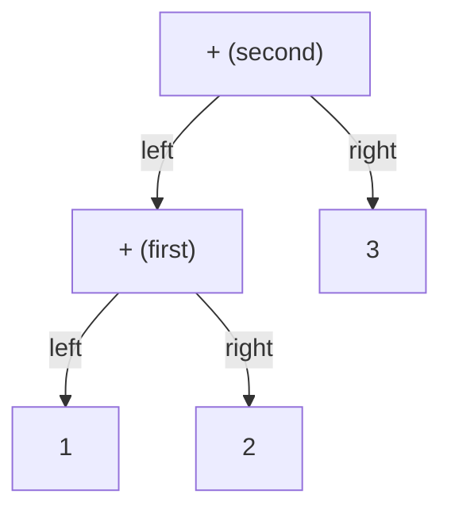

# Chapter 2. Organizing data in a hierarchy

We will connect items with parent-child relationships. Then we will use the structure to represent an expression.

## Thinking logically

### What does hierarchical data look like?

We use nodes, which have data and child links to other nodes. An array stores nodes side by side; child links give them a hierarchy. We call this structure a tree: every node has at most one parent, and the one node with no parent is the root. Following parents upward from any node in the tree always leads back to that root.

### How do array positions become a tree?

We use indices of other nodes in the array as child links. Let's consider a common tree structure called a binary tree, whose nodes have at most two child links. Because the maximum number of children is two, each node stores two indices: `left` and `right`. A value of `-1` means no child.

### How do we access the whole tree?

Starting at the root, we follow each child link that isn't `-1`, and repeat this for every descendant until we've visited the whole tree.

### How do we connect a node to this data structure?

Store its index in a parent's child link. To introduce a new root, connect the old root beneath the new parent, then update the root index.

### How can a tree represent an expression?

Consider an expression built from a binary operator such as `+`. Each operator has two operands, and each operand can itself be an expression with its own operator. We model this with the operator as a parent node and its operands as its child nodes. A number has no children, so both its links are `-1`.

For example, `1+2+3` is evaluated as `(1+2)+3`. The first `+` has children `1` and `2`. The second `+` has the first `+` and `3` as its children, so it becomes the root.

### How do we build an addition tree from an expression?

Let's see how that tree is built.

First, prepare one node for each character: `1`, `+`, `2`, `+`, and `3`. The two `+` characters occupy separate nodes. Initially, none of the nodes has children, so every node's `left` and `right` are `-1`.

1. Start with the first number. The node containing `1` is the root of our initial tree, representing just `1`.
2. Connect the first addition. Make the first `+` node the parent of the current root and the node containing `2`. The old root becomes its left child, and `2` becomes its right child. This `+` becomes the new root, representing `1+2`.
3. Connect the next addition. Make the second `+` node the parent of the current root and the node containing `3`. The entire tree for `1+2` is now on its left, and `3` is on its right. This second `+` becomes the root of the whole expression.



The same rule applies whenever another `+` and number follow: attach the current root on the new operator's left, attach the next number on its right, and make the operator the new root.

Throughout construction, the current root gives us access to everything connected so far. We are recording how the expression is grouped; calculating its value comes next.

### How do we calculate the value of the expression?

A number node returns its integer value. A `+` node first asks its left subtree (the left child and all its descendants) for a value, then its right subtree, and returns their sum.

The root asks its left child, the first `+`. That node gets `1` and `2` and returns `3`. The root then gets `3` from its right child and returns `6`.

## Calculating efficiency

### Memory efficiency for storing

A node stores one `char` and two `int` members. The array reserves all its slots even when only some are in use.

### Memory efficiency for iterating over items

Each node still waiting for its children's answers keeps its own temporary state. At most, the number of waiting nodes equals the number of nodes on the path from the root to the deepest node.

### Efficiency of creating or adding one item

Initializing one node or assigning one child link takes constant time.

### Efficiency of iterating over items

Traversal and evaluation do work proportional to the number of nodes reachable from the starting root, assuming a valid tree. Unconnected array entries are not visited.

## Glossary

### Node

One character together with its left and right child indices.

### Tree

A connected hierarchy with one root, no cycles, and one parent per non-root node.

### Binary tree

A tree with at most two children per node, distinguished as left and right.

### Expression tree

A tree whose leaves hold numbers and whose internal nodes hold operators.

### Root

The one node with no parent; the whole tree is accessed from it.

### Parent

A node directly above its child.

### Child

A node directly linked below its parent.

### Ancestor

A node on the path from the root to a given node, above that node.

### Descendant

A node reached by following child links downward.

### Leaf

A node with no children; both child indices are `-1`.

### Subtree

A node and all its descendants.

### Recursion

A function calling itself, with separate parameter and local values for each call.

### Base case

A case that finishes without making another recursive call.

## Invariant

### What are the invariants (the golden rules) in this data structure?

- An absent child is `-1`; a present child is an index from `0` through the number of nodes in use minus one.
- Within one tree, each non-root node has one parent and there are no cycles.

### What is the benefit of the invariants?

Because every link is either `-1` or a valid index, and no node is shared or part of a cycle, following each link that isn't `-1` from the root visits every node in the tree exactly once.

### What happens if an invariant is broken?

An index outside the valid range reads a slot that holds no node, or memory outside the array. Shared children can be visited repeatedly. A cycle can make recursion continue indefinitely.

### How do we keep the invariants intact?

Initialize before connecting. Preserve valid child indices and the intended tree shape.

## Coding plan

### Designing a node

Keep `data`, `left`, and `right` in `struct TreeNode`; store ten such nodes in a shared array.

### Preparing the alphabet tree

Before the expression, we practice on a small tree of letters.

1. Initialize ten nodes as `A` through `J`, with no children.
2. Connect `A` to `B` and `C`, and `B` to `D` and `E`.
3. Make `F` the root above `A` and `G`.

### Reading the alphabet tree

Visit the left subtree, then the right subtree, then read the current node. Starting at `F`, the read order is `D E B C A G F`. Reading a character here does not print it.

### Preparing an addition tree

For simplicity, this example uses single-digit numbers separated by `+`.

1. Copy the five characters of `1+2+3` into the shared nodes and reset their child links.
2. Start with the first number as root.
3. For each operator and following number, attach the old root on the operator's left and the number on its right, then make that operator the new root.

### Evaluating an expression tree

Return a number's integer value directly. Otherwise evaluate the left child into `l`, the right child into `r`, and return `l + r`.

## New C syntax explained

### Defining a `struct` tag

`struct TreeNode { ... };` defines a type containing named members. The final semicolon is required.

### Using a `struct` tag

`struct TreeNode nodes[10];` declares an array of ten nodes. Valid array indices are `0` through `9`.

### `.` (accessing members)

`nodes[i].left` selects array element `i`, then its `left` member. The stored integer is a child's index, not the child's character or calculated value.

### Postfix increment

`i++` supplies the old value of `i` and then increases `i` by one. In `int root = i++;`, starting with `i = 0` gives `root = 0` and leaves `i = 1`.

### Recursive functions

The caller waits while a child call runs, then resumes at the next statement.

### Mathematical integer value corresponding to digit character

The characters `'0'` through `'9'` have consecutive codes, so for a digit character `data`, `data - '0'` gives its integer value. For example, `'1' - '0'` is `1`.

## C code

### Node storage

```c
struct TreeNode {
        char data; // A stored character, not an evaluated result.
        int left; // Left child's array index; -1 means no child.
        int right; // Right child's array index; -1 means no child.
};
struct TreeNode nodes[10];
int capacity = 10;
int nodes_size = 0; // Initialized slots, not the number reachable from one root.
```

### Initializing alphabet nodes

```c
void alphabet_init() {
        // Initialize every reserved slot as a separate node.
        nodes_size = capacity;
        for (int i = 0; i < capacity; i++) {
                nodes[i].data = 'A' + i;
                // Zero is a valid index, so absent children must use -1.
                nodes[i].left = nodes[i].right = -1;
        }
}
```

### Connecting the alphabet tree

```c
int tree_connect() {
        int root = 0; // Start with A at index 0.
        // A owns B and C; B owns D and E.
        nodes[root].left = 1;
        nodes[root].right = 2;
        nodes[1].left = 3;
        nodes[1].right = 4;
        // F adopts the old subtree before replacing its root. No node moves.
        nodes[5].left = root;
        root = 5;
        nodes[5].right = 6;
        return root; // Return F's index, not its character.
}
```

### Reading nodes recursively

```c
void tree_recursion(int i) {
        // An absent child or out-of-range index finishes without accessing a node.
        if (i >= 0 && i < nodes_size) {
                // Finish the entire left subtree, then the entire right subtree.
                tree_recursion(nodes[i].left);
                tree_recursion(nodes[i].right);
                // Read the current character only after both calls return; no printing.
                int data_read = nodes[i].data;
        }
}
```

### Initializing an addition expression
```c
void eq_plus_init() {
        // The classroom input alternates single digits and +.
        char eq[10] = "1+2+3";
        int eq_size = 5; // Count expression characters, excluding the string terminator.
        nodes_size = eq_size;
        // Copy each character and clear its links before building the tree.
        for (int i = 0; i < eq_size; i++) {
                nodes[i].data = eq[i];
                nodes[i].left = nodes[i].right = -1;
        }
}
```

### Connecting an addition tree

```c
int eq_plus_connect() {
        // Requires initialized single digits alternating with +, ending in a digit.
        int i = 0;
        // Postfix increment selects the current index, then advances to the next one.
        int root = i++;
        while (i < nodes_size) {
                int op = i++;
                int num = i++;
                // The new plus adopts the old tree and next digit, then becomes root.
                nodes[op].left = root;
                nodes[op].right = num;
                root = op;
        }
        return root; // Return an index; evaluating the expression is a separate step.
}
```

### Evaluating an addition tree

```c
int eval(int i) {
        // Requires a valid digit leaf or a + node with two valid children.
        if (nodes[i].data >= '0'
                && nodes[i].data <= '9') {
                // The digit base case returns an integer without following child links.
                return nodes[i].data - '0';
        }
        // Each call keeps its own returned child values, not child indices.
        int l = eval(nodes[i].left);
        int r = eval(nodes[i].right);
        return l + r; // Return the subtree's sum without changing any stored node.
}
```
