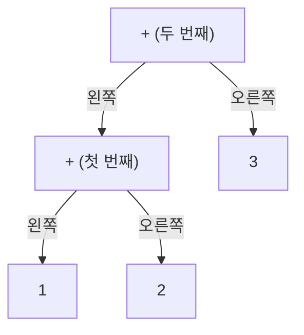

# 제2장. data에 계층을 부여하기

항목들을 부모·자식 관계로 연결한다. 그런 다음 그 구조로 수식을 표현한다.

## 논리적으로 생각해 보기

### 계층 구조를 가진 data는 어떤 모습일까?

data와 다른 노드를 향하는 자식 링크를 담은 노드를 사용한다. 배열은 노드를 나란히 저장하고, 자식 링크는 그 노드들에 계층을 부여한다. 이 구조를 트리라고 한다. 각 노드는 부모를 최대 하나만 가진다. 부모가 없는 단 하나의 노드가 root다. 트리의 어느 노드에서든 부모를 따라 올라가면 그 root에 도달한다.

### 배열의 위치를 어떻게 트리로 연결할까?

배열에 있는 다른 노드의 인덱스를 자식 링크로 사용한다. 노드마다 자식 링크를 최대 두 개 가지는 이진 트리를 생각해보자. 자식 수가 최대 두 개이므로 각 노드는 자식 인덱스를 저장할 `left`와 `right` 두 칸을 가진다. 값이 `-1`이면 자식이 없다는 뜻이다.

### 트리 전체에 어떻게 접근할까?

root에서 시작해 `-1`이 아닌 자식 링크를 따라간다. 모든 자손에 대해 같은 과정을 반복하면 트리 전체를 방문할 수 있다.

### 이 자료구조에 노드를 어떻게 연결할까?

부모의 자식 링크에 노드의 인덱스를 저장한다. 새 root를 만들려면 기존 root를 새 부모 아래에 연결하고, root 인덱스를 새 부모의 인덱스로 바꾼다.

### 트리로 수식을 어떻게 표현할까?

`+`처럼 두 값을 연산하는 이항 연산자로 만든 수식을 생각해보자. 각 연산자는 두 피연산자를 가진다. 각 피연산자도 자신의 연산자를 가진 수식일 수 있다. 연산자를 부모 노드로, 두 피연산자를 자식 노드로 표현한다. 숫자는 자식이 없으므로 두 링크 모두 `-1`이다.

예를 들어 `1+2+3`은 `(1+2)+3`으로 계산한다. 첫 번째 `+`의 자식은 `1`과 `2`다. 두 번째 `+`의 자식은 첫 번째 `+`와 `3`이다. 따라서 두 번째 `+`가 root가 된다.

### 수식으로 덧셈 트리를 어떻게 만들까?

이 트리를 만드는 과정을 살펴보자.

먼저 각 문자 `1`, `+`, `2`, `+`, `3`마다 노드를 하나씩 준비한다. 두 개의 `+` 문자는 서로 다른 노드에 저장한다. 처음에는 모든 노드에 자식이 없으므로 각 노드의 `left`와 `right`가 모두 `-1`이다.

1. 첫 번째 숫자부터 시작한다. `1`을 저장한 노드가 처음 트리의 root가 되며, 이 트리는 `1`만을 나타낸다.
2. 첫 번째 덧셈을 연결한다. 첫 번째 `+` 노드를 현재 root와 `2`를 저장한 노드의 부모로 만든다. 기존 root는 왼쪽 자식이 되고, `2`는 오른쪽 자식이 된다. 이 `+`가 새로운 root가 되어 `1+2`를 나타낸다.
3. 다음 덧셈을 연결한다. 두 번째 `+` 노드를 현재 root와 `3`을 저장한 노드의 부모로 만든다. 이제 왼쪽에는 `1+2`를 나타내는 트리 전체가 있고, 오른쪽에는 `3`이 있다. 이 두 번째 `+`가 전체 수식의 root가 된다.



뒤에 `+`와 숫자가 더 이어질 때에도 같은 규칙을 적용한다. 새 연산자의 왼쪽에 현재 root를 연결하고, 오른쪽에 다음 숫자를 연결한 뒤, 그 연산자를 새로운 root로 삼는다.

트리를 만드는 동안 현재 root를 통해 지금까지 연결한 모든 노드에 접근할 수 있다. 지금은 수식이 어떻게 묶이는지를 기록하는 과정이다. 그 값을 계산하는 일은 트리를 만든 다음에 한다.

### 수식의 값을 어떻게 계산할까?

숫자 노드는 자신의 정수값을 반환한다. `+` 노드는 왼쪽 서브트리(왼쪽 자식과 그 자식의 모든 자손)의 값을 먼저 구하고, 오른쪽 서브트리의 값을 구한 다음 두 값의 합을 반환한다.

root는 왼쪽 자식인 첫 번째 `+`에 값을 요청한다. 첫 번째 `+`는 `1`과 `2`를 받아 `3`을 반환한다. root는 이어서 오른쪽 자식으로부터 `3`을 받아 `6`을 반환한다.

## 효율 계산해보기

### 저장할 때의 메모리 효율

노드는 `char` 멤버 하나와 `int` 멤버 두 개를 저장한다. 배열은 일부 칸만 사용하더라도 모든 칸의 공간을 확보한다.

### 순회할 때의 메모리 효율

자식의 결과를 기다리는 노드마다 자신의 임시 상태를 보관한다. 기다리는 노드 수는 많아도 root에서 가장 깊은 노드까지의 경로에 있는 노드 수를 넘지 않는다.

### 항목 하나를 만들거나 추가하는 효율

노드 하나를 초기화하거나 자식 링크 하나를 대입하는 데는 상수 시간이 든다.

### 항목을 순회하는 효율

올바른 트리에서 순회와 계산의 작업량은 시작 root로부터 도달하는 노드 수에 비례한다. 연결되지 않은 배열 원소는 방문하지 않는다.

## 용어 정리

### 노드 (Node)

문자 하나와 왼쪽·오른쪽 자식의 인덱스를 함께 저장한 것.

### 트리 (Tree)

root 하나를 가지며, 순환이 없고 root 이외의 각 노드에 부모가 하나씩 있는 연결된 계층 구조.

### 이진 트리 (Binary Tree)

노드마다 최대 두 자식을 가지며, 왼쪽과 오른쪽을 구분하는 트리.

### 수식 트리 (Expression Tree)

단말 노드에 숫자를, 내부 노드에 연산자를 저장한 트리.

### root

부모가 없는 단 하나의 노드. 이 노드에서 트리 전체에 접근한다.

### 부모 (Parent)

자식 바로 위에 있는 노드.

### 자식 (Child)

부모 바로 아래에 연결된 노드.

### 조상 (Ancestor)

root에서 주어진 노드까지의 경로에 있으며, 주어진 노드보다 위에 있는 노드.

### 자손 (Descendant)

자식 링크를 따라 아래로 내려가면 도달하는 노드.

### 단말 (Leaf)

자식이 없어 두 자식 인덱스가 모두 `-1`인 노드.

### 서브트리 (Subtree)

어떤 노드와 그 노드의 모든 자손으로 이루어진 트리.

### 재귀 (Recursion)

함수가 자기 자신을 호출하는 것. 각 호출은 별도의 매개변수와 지역 변수 값을 가진다.

### 종료 조건 (Base Case)

다른 재귀 호출을 만들지 않고 끝나는 경우.

## 규칙

### 이 자료구조의 규칙은 무엇일까?

- 자식이 없으면 `-1`을 저장한다. 자식이 있으면 `0`부터 사용 중인 노드 수에서 1을 뺀 값까지의 인덱스를 저장한다.
- 한 트리 안에서 root 이외의 노드는 부모가 하나씩 있으며, 순환이 없다.

### 규칙을 지키면 무엇이 좋을까?

모든 링크가 `-1`이거나 유효한 인덱스이고, 노드를 공유하거나 순환하는 부분이 없다. 따라서 root에서 `-1`이 아닌 각 링크를 따라가면 트리의 모든 노드를 정확히 한 번씩 방문한다.

### 규칙이 깨지면 어떻게 될까?

유효한 범위를 벗어난 인덱스는 노드가 없는 칸이나 배열 밖의 메모리를 읽게 한다. 자식을 공유하면 같은 노드를 여러 번 방문할 수 있다. 순환이 있으면 재귀가 끝나지 않을 수 있다.

### 규칙을 어떻게 지킬까?

연결 전에 초기화한다. 자식 인덱스와 의도한 트리 모양을 올바르게 유지한다.

## 코딩 계획

### 노드 설계하기

`struct TreeNode`에 `data`, `left`, `right`를 두고, 공유 배열에 노드 열 개를 저장한다.

### 알파벳 트리 준비하기

수식을 다루기 전에 작은 문자 트리로 연습한다.

1. 열 노드를 `A`부터 `J`까지의 문자와 자식이 없는 상태로 초기화한다.
2. `A`에 `B`, `C`를 연결하고, `B`에 `D`, `E`를 연결한다.
3. `F`를 `A`와 `G` 위의 root로 만든다.

### 알파벳 트리 읽기

왼쪽 서브트리, 오른쪽 서브트리, 현재 노드 순서로 읽는다. `F`에서 시작하면 읽는 순서는 `D E B C A G F`이다. 여기서 문자를 읽는다고 화면에 출력되지는 않는다.

### 덧셈 트리 준비하기

예제를 단순하게 유지하기 위해 `+`로 구분한 한 자리 숫자만 사용한다.

1. `1+2+3`의 다섯 문자를 공유 노드에 복사하고 자식 링크를 초기화한다.
2. 첫 숫자를 root로 시작한다.
3. 각 연산자와 그다음 숫자를 처리하면서 연산자의 왼쪽에 기존 root를, 오른쪽에 숫자를 연결한 뒤, 그 연산자를 새로운 root로 삼는다.

### 수식 트리 계산하기

숫자이면 해당 정수값을 바로 반환한다. 그렇지 않으면 왼쪽 자식의 결과를 `l`에, 오른쪽 자식의 결과를 `r`에 저장하고 `l + r`을 반환한다.

## 새로운 C 문법 설명

### `struct` 태그 정의하기

`struct TreeNode { ... };`는 이름 있는 멤버들을 묶은 타입을 정의한다. 마지막 세미콜론도 필요하다.

### `struct` 태그 사용하기

`struct TreeNode nodes[10];`은 노드 열 개의 배열을 선언한다. 배열의 유효한 인덱스는 `0`부터 `9`까지다.

### `.` (멤버 접근하기)

`nodes[i].left`는 배열의 `i`번 원소를 선택한 뒤 그 원소의 `left` 멤버에 접근한다. 저장된 정수는 자식의 인덱스이며, 자식의 문자나 계산 결과가 아니다.

### postfix 증가 연산자

`i++`는 증가하기 전의 `i` 값을 사용한 뒤 `i`를 1 증가시킨다. `i = 0`에서 `int root = i++;`를 실행하면 `root = 0`, `i = 1`이 된다.

### 재귀 함수

호출한 함수는 자식 호출이 끝날 때까지 기다리고, 이후 다음 문장부터 계속한다.

### 숫자 문자에 해당하는 정수값

문자 `'0'`부터 `'9'`까지의 코드는 연속한다. 따라서 숫자 문자 `data`에서 `'0'`을 뺀 `data - '0'`은 해당 숫자의 정수값이다. 예를 들어 `'1' - '0'`은 `1`이다.

## C 코드

### 노드 저장 공간

타입, 배열, 용량, 사용 중인 칸의 수가 각각 무엇인지 설명해보자.

```c
struct TreeNode {
        char data; // 문자를 저장한다. 계산 결과가 아니다.
        int left; // 왼쪽 자식의 배열 인덱스다. -1은 자식 없음을 뜻한다.
        int right; // 오른쪽 자식의 배열 인덱스다. -1은 자식 없음을 뜻한다.
};
struct TreeNode nodes[10];
int capacity = 10;
int nodes_size = 0; // 초기화한 칸의 수다. 한 root에서 도달하는 노드 수가 아니다.
```

### 알파벳 노드 초기화하기

각 칸에 문자와 두 개의 자식 없음 표시가 어떻게 저장되는지 설명해보자.

```c
void alphabet_init() {
        // 확보한 모든 칸을 서로 연결되지 않은 노드로 초기화한다.
        nodes_size = capacity;
        for (int i = 0; i < capacity; i++) {
                nodes[i].data = 'A' + i;
                // 0은 유효한 인덱스이므로 자식이 없을 때는 -1을 사용한다.
                nodes[i].left = nodes[i].right = -1;
        }
}
```

### 알파벳 트리 연결하기

각 연결과 이 함수가 `5`를 반환하는 이유를 설명해보자.

```c
int tree_connect() {
        int root = 0; // 인덱스 0의 A에서 시작한다.
        // A의 자식은 B와 C, B의 자식은 D와 E다.
        nodes[root].left = 1;
        nodes[root].right = 2;
        nodes[1].left = 3;
        nodes[1].right = 4;
        // F 아래에 기존 서브트리를 연결한 뒤 root를 바꾼다. 노드는 이동하지 않는다.
        nodes[5].left = root;
        root = 5;
        nodes[5].right = 6;
        return root; // F의 문자가 아닌 인덱스를 반환한다.
}
```

### 재귀로 노드 읽기

언제 `data_read`에 값이 저장되는지, `i = -1`이면 어떻게 되는지 설명해보자.

```c
void tree_recursion(int i) {
        // 자식이 없거나 인덱스가 범위 밖이면 노드에 접근하지 않고 끝난다.
        if (i >= 0 && i < nodes_size) {
                // 왼쪽 서브트리 전체를 처리한 뒤 오른쪽 서브트리 전체를 처리한다.
                tree_recursion(nodes[i].left);
                tree_recursion(nodes[i].right);
                // 두 호출이 모두 끝난 뒤 현재 문자를 읽는다. 출력하지는 않는다.
                int data_read = nodes[i].data;
        }
}
```

### 덧셈 수식 초기화하기

어떤 다섯 문자가 복사되며 왜 `nodes_size`가 `5`가 되는지 설명해보자.

```c
void eq_plus_init() {
        // 수업 입력은 한 자리 숫자와 +가 번갈아 나온다.
        char eq[10] = "1+2+3";
        int eq_size = 5; // 문자열 종료 문자를 제외한 수식 문자 수다.
        nodes_size = eq_size;
        // 트리를 만들기 전에 각 문자를 복사하고 자식 링크를 초기화한다.
        for (int i = 0; i < eq_size; i++) {
                nodes[i].data = eq[i];
                nodes[i].left = nodes[i].right = -1;
        }
}
```

### 덧셈 트리 연결하기

두 번의 반복에서 `i`, `op`, `num`, `root` 값이 어떻게 변하는지 설명해보자.

```c
int eq_plus_connect() {
        // 한 자리 숫자와 +가 번갈아 나오고 숫자로 끝나는 초기화된 입력을 가정한다.
        int i = 0;
        // postfix 증가 연산자는 현재 인덱스를 사용한 뒤 다음 인덱스로 이동한다.
        int root = i++;
        while (i < nodes_size) {
                int op = i++;
                int num = i++;
                // 새 +에 기존 트리와 다음 숫자를 연결한 뒤 새 +를 root로 삼는다.
                nodes[op].left = root;
                nodes[op].right = num;
                root = op;
        }
        return root; // 인덱스를 반환한다. 수식 계산은 별도 단계다.
}
```

### 덧셈 트리 계산하기

숫자는 왜 즉시 반환하고, 각 덧셈은 왜 두 결과를 기다리는지 설명해보자.

```c
int eval(int i) {
        // 올바른 숫자 단말 또는 유효한 두 자식을 가진 + 노드를 가정한다.
        if (nodes[i].data >= '0'
                && nodes[i].data <= '9') {
                // 숫자인 종료 조건에서는 자식 링크를 따라가지 않고 정수를 반환한다.
                return nodes[i].data - '0';
        }
        // 각 호출은 자식 인덱스가 아닌 자식의 반환값을 따로 보관한다.
        int l = eval(nodes[i].left);
        int r = eval(nodes[i].right);
        return l + r; // 저장된 노드를 바꾸지 않고 서브트리의 합을 반환한다.
}
```
