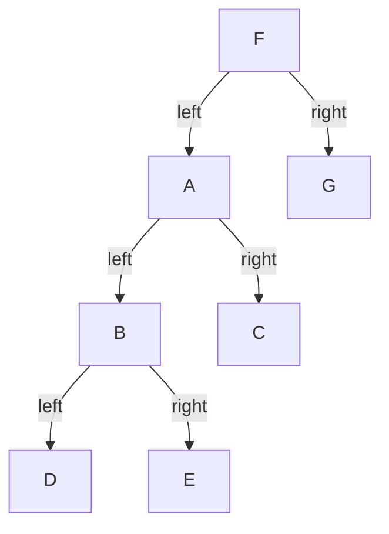
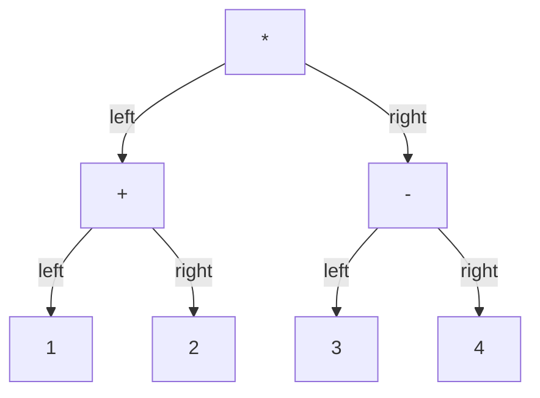

# Chapter 5. Visiting nodes in a tree

We will visit a tree's nodes in different orders and use a stack to remember unfinished work. Then we will build an expression tree from postfix notation and write its infix expression.

## Thinking logically

### How do we explore a whole tree?

We start at the root and follow its child links. To explore a node's subtree, explore its left subtree, then its right subtree. Apply the same rule wherever a subtree starts. An absent child has index `-1`, so there is nothing to explore and we return immediately.

Let's use the alphabet tree from Chapter 2. Its root is `F`.



Starting at `F`, we follow the left links through `A` and `B` to `D`. After finishing `D`, we return to `B` and explore `E`. We finish each subtree before returning to the remaining work above it. This is depth-first traversal.

### When do we process each node's data?

There are three places to process the current node: before exploring either child, between the two child subtrees, or after finishing both. We call this processing a visit. It might read a character, record it, or use it in a calculation.

- Preorder visits the current node, then the left subtree, then the right subtree: `F A B D E C G`.
- Inorder visits the left subtree, then the current node, then the right subtree: `D B E A C F G`.
- Postorder visits the left subtree, then the right subtree, then the current node: `D E B C A G F`.

Chapter 2 read each character after both child calls returned, so it used postorder. Moving the visit changes the processing order without changing any child links. The traversal code below marks all three positions with comments; those comments do not themselves read or print data.

### How does recursion remember unfinished work?

Each function call keeps its own node index and the place where it will continue. When `B` calls its left child `D`, the call for `B` waits. When `D` returns, `B` resumes after that call, ready for its inorder visit and right subtree.

A call with an absent child returns immediately. This base case lets leaf calls finish, then their parents, until the root's entire subtree is complete.

### How can a stack remember the same work?

Store unfinished node indices on a stack. Keep a separate progress value for each node, recording the next step to perform when that node reaches the top again.

1. At step 0, perform the preorder visit and push the left child.
2. At step 1, perform the inorder visit and push the right child.
3. At step 2, perform the postorder visit and pop the current node.

Advance the parent's progress before pushing its child. The parent then waits below the child with its next step already recorded. If the top is `-1`, pop it immediately because that subtree is empty.

After `B` pushes `D`, `B`'s progress is 1. When `D` is finished and removed, `B` becomes top again and continues with step 1. This makes the waiting work explicit instead of leaving it to recursive calls.

### How do we build an expression tree from postfix notation?

Chapter 4 kept operand values on a stack to evaluate postfix. Here we keep subtree root indices instead. A digit creates a leaf. An operator joins the two most recent subtrees beneath a new parent.

For example, read `12+34-*` from left to right:

1. Make leaves for `1` and `2`, pushing each index.
2. At `+`, pop `2` as the right child and `1` as the left child. Connect them to the new `+` node and push its index.
3. Make leaves for `3` and `4`, then join them under `-`, again popping the right child first.
4. At `*`, pop the `-` subtree as the right child and the `+` subtree as the left child. Push the new root.



The result represents `(1+2)*(3-4)`. We have recorded the expression's grouping without calculating its value. The right child comes off first because it was pushed later; reversing the children of `-` would change `3-4` to `4-3`.

Each operator needs two waiting subtrees, and a complete expression leaves exactly one root. Postfix matches postorder because an operator follows both of its operands.

### Why does inorder sometimes need parentheses?

Reading this expression tree in inorder gives `1+2*3-4`. That text would multiply `2` and `3` first, but the tree requires the addition and subtraction to finish before multiplication. We need `(1+2)*(3-4)` to preserve its grouping.

A digit can be written directly. For an operator, write the left subtree, the operator, and the right subtree, adding parentheses where the child's operation must stay together.

### How do we decide where parentheses belong?

Multiplication, division, and remainder have higher precedence than addition and subtraction. For the binary operators `+`, `-`, `*`, `/`, and `%`, use these rules:

- Parenthesize a left child when its operator has lower precedence than its parent's.
- Parenthesize a right child when its operator has lower or equal precedence to its parent's.

Equal-precedence operators group from left to right. A left child is already grouped first, but a right child may need parentheses. For example, the tree for `8-(3-2)` must keep its right subtraction together; writing `8-3-2` would change the grouping.

Open a parenthesis before writing the child subtree and close it afterward. These rules preserve the tree's grouping, even when an arithmetic identity could remove some parentheses.

### How can two traversal orders reconstruct a tree?

With distinct node labels, preorder and inorder together determine the tree. Let's reconstruct our alphabet tree from preorder `F A B D E C G` and inorder `D B E A C F G`.

1. The first preorder label, `F`, is the root.
2. Split inorder at `F`: `D B E A C` belongs to its left subtree, and `G` to its right.
3. The left subtree has five nodes, so its preorder segment is `A B D E C`. Its root is `A`.
4. Split that subtree's inorder at `A`: `D B E` is on the left, and `C` on the right. Repeat until each subtree is a single node or empty.

This is an optional extension of the same recursive idea. Preorder alone cannot distinguish a sole left child from a sole right child. Repeated labels can also make the inorder split ambiguous.

## Calculating efficiency

### Memory efficiency for storing

We reuse Chapter 2's ten nodes and Chapter 4's ten-entry integer stack. The progress array adds ten integers, and the infix output reserves twenty characters. These arrays reserve all their slots even when only some are used.

The postfix buffer holds seven tokens plus its terminator. Parentheses can make the output longer: `1234+++` becomes `1+(2+(3+4))`, requiring twelve characters including the terminator. The current buffers fit valid inputs of this size; the code does not check capacities.

### Memory efficiency for iterating over items

Recursive calls keep the unfinished path from the root. The explicit traversal stack keeps the same path and can also hold one absent-child entry. Both grow with the tree's height; the explicit version also keeps one progress value per node slot.

A ten-node chain would need eleven entries in this traversal stack, exceeding its capacity of ten. The supplied alphabet tree fits. During postfix construction, the stack instead holds completed subtrees waiting for operators, so its required space can grow with the input length.

### Efficiency of creating or adding one item

Creating a digit leaf or connecting two waiting subtrees to an operator takes constant time. Building the complete expression tree takes time proportional to the number of postfix tokens.

### Efficiency of iterating over items

Recursive traversal, stack traversal, and infix writing take time proportional to the number of nodes reachable from the root, assuming a valid tree. Each node performs a fixed amount of work. Our alphabet tree reaches seven nodes even though ten array slots are initialized.

For the optional reconstruction, repeatedly scanning an inorder segment for its root can take quadratic time in a skewed tree. A prepared lookup from distinct labels to their inorder positions allows linear-time reconstruction.

## Glossary

### Depth-first traversal

Exploring a subtree completely before returning to the remaining branches.

### Visit

The selected action performed on a node's data.

### Preorder

Visiting the current node before its left and right subtrees.

### Inorder

Visiting the current node between its left and right subtrees.

### Postorder

Visiting the current node after its left and right subtrees.

### Call stack

Runtime storage for unfinished function calls and their local state.

### Progress

The next traversal step a node will perform when it becomes the stack's top again.

### Sentinel

A special value, here `-1`, representing an absent child.

### Postfix

Expression notation that places each operator after its operands.

### Infix

Expression notation that places each operator between its operands.

### Precedence

The priority that determines which operators bind more tightly.

### Left associativity

Grouping equal-precedence operators from left to right.

### Null terminator

The character `'\0'` marking the end of a C string.

## Invariant

### What are the invariants (the golden rules) in this data structure?

- Present child links select initialized nodes; absent children are `-1`. There are no cycles or shared children.
- Each recursive traversal call finishes its own subtree before returning to its parent.
- Real nodes on the traversal stack are unfinished nodes on the current path. Each node's progress records its next step; a negative top is removed immediately.
- After each postfix token, every stack entry is the root of a complete subexpression built from the processed tokens.
- During infix writing, the characters before `infix_pos` form the written prefix, and `infix_pos` is the next free position.

### What is the benefit of the invariants?

We can finish a child subtree and then resume its parent at the correct step. During construction, an operator can join two completed subtrees. During writing, each child appends to the existing output without overwriting it.

### What happens if an invariant is broken?

Invalid links can access memory outside the initialized nodes, and cycles can prevent traversal from finishing. Shared children can be visited repeatedly and do not fit the one-progress-value-per-node design. The traversal functions handle negative indices but do not check positive bounds.

An operator without two waiting roots makes postfix construction pop missing entries. An expression operator without two valid children makes the writer read invalid child data. Reversing children changes operand order, and resetting the output position inside recursive calls overwrites earlier characters.

### How do we keep the invariants intact?

Initialize nodes before connecting them and keep every push and write within its array's capacity. Supply a nonempty, valid postfix expression using single digits and binary `+`, `-`, `*`, `/`, or `%`. The builder treats every nondigit as an operator; it does not validate spaces, unary operators, multidigit numbers, or malformed expressions.

Start each stack traversal with zeroed progress. The wrapper clears the stack but leaves completed nodes at progress 3, so reset progress before another traversal, including after rebuilding a tree. Advance progress before descending into a child.

Use the infix writer on an expression tree with digit leaves and two valid children per operator. Reset its cursor once at the beginning of the complete write, share it across child calls, and append the terminator at the end.

## Coding plan

### Reusing nodes and the stack

Include Chapter 2's node definitions and Chapter 4's stack operations. Rename the stack's `capacity` during inclusion so the two globals have different names. The stack is shared by traversal, conversion, and construction; each operation uses it in turn.

### Visiting nodes recursively

Return immediately for a negative child index. Place the preorder visit before the left call, the inorder visit between the calls, and the postorder visit after the right call.

### Visiting nodes with a stack

1. Prepare zeroed progress, clear the stack, and push the root.
2. Read the top node and remove it immediately if it is negative.
3. Otherwise take its current progress step and advance the stored progress.
4. Push the left child, push the right child, or pop the node according to that step. Repeat until the stack is empty.

### Building an expression tree

Clear the stack and reset the node count. For each postfix character, create a node. Give a digit no children; give an operator the right and then left roots popped from the stack. Push the new node's index. Return the one remaining root after the final token.

Construction reuses the shared node array, replacing the earlier alphabet tree.

### Writing an infix expression

Give digits a precedence above every operator so they need no parentheses. Write a digit directly; otherwise write the left subtree, operator, and right subtree with the grouping rules above. Reset the output position in the outer function and terminate the string after the complete write.

## New C syntax explained

### Returning without a value

`return;` ends a `void` function immediately. We use it to finish an empty subtree or a single traversal step. By contrast, `return pop();` returns a node index from the tree builder.

### Initializing an array with `{0}`

`int progress[10] = {0};` initializes every entry to zero. This global initialization happens once; it does not reset the array each time a traversal starts.

### Saving a value with postfix increment

`int step = progress[i]++;` copies the old progress into `step`, then increases the stored progress. Starting at 0 gives `step == 0` and leaves `progress[i] == 1`, ready to resume after the left subtree finishes.

### Selecting a step with `switch`

`switch (step)` selects a matching `case`. Each case here ends with `return`, which leaves the entire helper. A `break` would leave only the switch.

### Negating a condition with `!`

`while (!is_empty())` repeats while the stack is not empty. The `!` operator turns a zero value into 1 and a nonzero value into 0.

### Writing and advancing an array position

`infix[infix_pos++] = c;` stores `c` at the current position, then advances the position. Recursive child calls share this global cursor.

### Ending a string with `'\0'`

`'\0'` is the zero-valued character that ends a C string. It is different from the visible digit `'0'` and needs its own array cell.

### Including definitions and renaming a token

`#include` inserts another source file during preprocessing. Here, `#define capacity stack_capacity` replaces the token `capacity` while including Chapter 4; `#undef capacity` ends that replacement. This changes a name, not the stack's runtime state.

## C code

### Reusing earlier definitions

```c
#include "module_02_binary_tree/student/lab.c"
// Give the stack's capacity a different name from the node array's capacity.
#define capacity stack_capacity
#include "module_04_stack/student/lab.c"
#undef capacity
```

The build uses the repository root as an include-search directory. These direct `.c` includes are a classroom shortcut; compile the driver once without separately linking the included files.

### Visiting nodes recursively

```c
void tree_traversal(int i) {
        // Finish an empty subtree before accessing a node.
        if (i < 0) {
                return;
        }
        // Preorder visit goes here, before either child subtree.
        tree_traversal(nodes[i].left);
        // Inorder visit goes here, after the entire left subtree.
        tree_traversal(nodes[i].right);
        // Postorder visit goes here, after both subtrees.
}
```

### Advancing one stack traversal step

```c
int progress[10] = {0}; // Initialize once; reset before another traversal.

void tree_traversal_proceed(int i) {
        // A pushed absent child has no progress entry to read.
        if (i < 0) {
                pop();
                return;
        }
        // Save this action and advance before a child can become top.
        int step = progress[i]++;
        switch (step) {
        case 0: // Preorder visit goes here.
                push(nodes[i].left);
                return;
        case 1: // Inorder visit goes here.
                push(nodes[i].right);
                return;
        case 2: // Postorder visit goes here.
                pop(); // Both children are finished; progress is now 3.
                return;
        }
}
```

### Repeating steps until the tree is finished

```c
void tree_traversal_with_stack(int root_index) {
        // Requires zeroed progress; this function resets only the stack.
        top = -1;
        push(root_index);
        while (!is_empty()) {
                // Read the top again because the previous step may have changed it.
                tree_traversal_proceed(peek());
        }
}
```

### Building a tree from postfix

```c
int build_tree_from_postfix() {
        // Requires valid, nonempty postfix that fits the shared arrays.
        top = -1;
        nodes_size = 0;
        for (int i = 0; postfix[i] != '\0'; i++) {
                char c = postfix[i];
                nodes[i].data = c; // Store the character, not an evaluated value.
                if (c >= '0' && c <= '9') {
                        nodes[i].left = -1;
                        nodes[i].right = -1;
                } else {
                        // The later operand is on top, so take the right child first.
                        nodes[i].right = pop();
                        nodes[i].left = pop();
                }
                push(i); // This node roots a completed subexpression.
                ++nodes_size;
        }
        return pop(); // Valid input leaves exactly one root.
}
```

### Preparing the output and precedence

```c
char infix[20] = "";
int infix_pos = 0;

int prec2(char c) {
        if (c >= '0' && c <= '9') {
                return 3; // Digits bind more tightly than every supported operator.
        } else {
                return prec(c); // Chapter 4 supplies the operator precedence.
        }
}

void write_char(char c) {
        infix[infix_pos++] = c; // Append at the position shared by all child calls.
}
```

### Writing a subtree with parentheses

```c
void _write_infix(int i) {
        if (i < 0) {
                return;
        }
        char c = nodes[i].data;
        if (c >= '0' && c <= '9') {
                write_char(c); // A digit leaf needs no child calls or parentheses.
                return;
        }
        // An operator requires two valid children before their data is read.
        char l = nodes[nodes[i].left].data;
        char r = nodes[nodes[i].right].data;

        // Before the left subtree, open any parentheses it needs.
        if (prec2(l) < prec2(c)) {
                write_char('(');
        }
        _write_infix(nodes[i].left);

        // Between subtrees, close the left group and write the operator.
        if (prec2(l) < prec2(c)) {
                write_char(')');
        }
        write_char(c);

        // Equal precedence on the right also needs grouping.
        if (prec2(r) <= prec2(c)) {
                write_char('(');
        }
        _write_infix(nodes[i].right);

        // After the right subtree, close its group.
        if (prec2(r) <= prec2(c)) {
                write_char(')');
        }
}
```

### Starting and finishing a complete write

```c
void write_infix(int root) {
        infix_pos = 0; // Restart once for the complete expression.
        _write_infix(root);
        write_char('\0'); // Terminate after every subtree has been written.
}
```

Repeated calls replace the output from its first character. `write_infix(-1)` writes an empty string; a nonnegative root must select a valid expression tree.

The supplied [lecture driver](../code/lecture/lab_demo.c) demonstrates both traversals and expression writing. From `module_05_tree_dfs/code`, run `make lecture` or `make lab-tests`; see the [code guide](../code/README.md) for build details.
