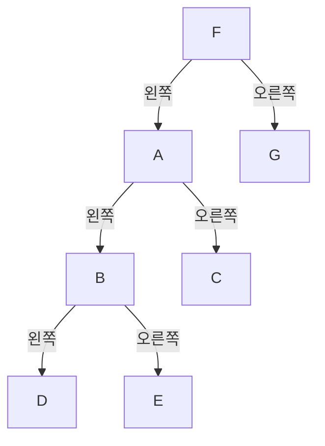
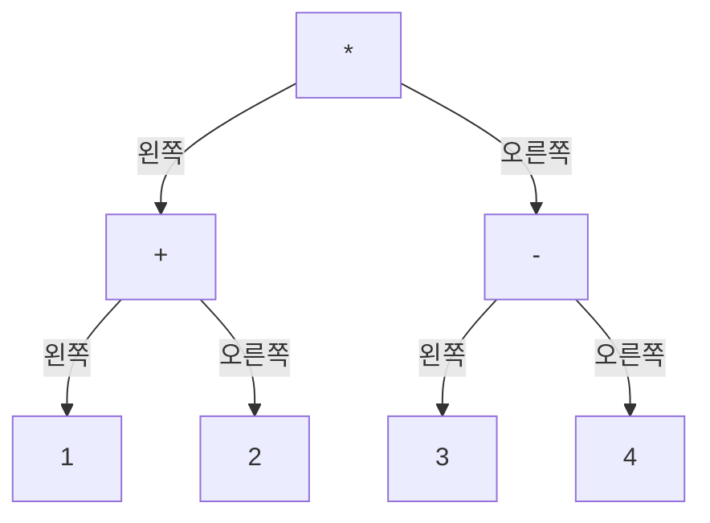

# 제5장. 트리의 노드 방문하기

트리의 노드를 여러 순서로 방문하고, 스택으로 아직 끝나지 않은 작업을 기억한다. 그런 다음 postfix 표기식으로 수식 트리를 만들고 infix 표기식으로 쓴다.

## 논리적으로 생각해 보기

### 트리 전체를 어떻게 탐색할까?

root에서 시작해 자식 링크를 따라간다. 어떤 노드의 서브트리를 탐색하려면 왼쪽 서브트리를 먼저 탐색하고, 이어서 오른쪽 서브트리를 탐색한다. 서브트리가 시작하는 곳마다 같은 규칙을 적용한다. 자식이 없으면 인덱스가 `-1`이므로 탐색할 것이 없어 바로 반환한다.

2장의 알파벳 트리를 사용해보자. 이 트리의 root는 `F`다.



`F`에서 왼쪽 링크를 따라 `A`, `B`를 거쳐 `D`로 간다. `D`를 끝내면 `B`로 돌아와 `E`를 탐색한다. 각 서브트리를 끝낸 뒤 위쪽에서 기다리던 나머지 작업으로 돌아간다. 이것이 깊이 우선 순회다.

### 각 노드의 data는 언제 처리할까?

현재 노드를 처리할 수 있는 위치는 세 곳이다. 어느 자식도 탐색하기 전, 두 자식 서브트리 사이, 두 서브트리를 모두 끝낸 뒤다. 이 처리를 방문이라고 한다. 문자를 읽거나 기록할 수도 있고, 계산에 사용할 수도 있다.

- preorder는 현재 노드, 왼쪽 서브트리, 오른쪽 서브트리 순서로 방문한다. 순서는 `F A B D E C G`다.
- inorder는 왼쪽 서브트리, 현재 노드, 오른쪽 서브트리 순서로 방문한다. 순서는 `D B E A C F G`다.
- postorder는 왼쪽 서브트리, 오른쪽 서브트리, 현재 노드 순서로 방문한다. 순서는 `D E B C A G F`다.

2장에서는 두 자식 호출이 모두 반환한 뒤 각 문자를 읽었으므로 postorder를 사용했다. 방문 위치를 옮기면 자식 링크를 바꾸지 않고도 처리 순서를 바꿀 수 있다. 아래 순회 코드는 세 위치를 모두 주석으로 표시한다. 주석 자체가 data를 읽거나 출력하지는 않는다.

### 재귀는 아직 끝나지 않은 작업을 어떻게 기억할까?

각 함수 호출은 자신의 노드 인덱스와 실행을 이어갈 위치를 기억한다. `B`에서 왼쪽 자식 `D`를 호출하면 `B`의 호출은 기다린다. `D`가 반환하면 `B`는 그 호출 다음부터 계속하여 inorder 방문과 오른쪽 서브트리를 처리할 준비가 된다.

없는 자식에 대한 호출은 바로 반환한다. 이 종료 조건 덕분에 단말의 호출이 끝나고, 이어서 부모의 호출이 끝나며, 마지막에는 root의 서브트리 전체가 끝난다.

### 스택으로 같은 작업을 어떻게 기억할까?

아직 끝나지 않은 노드의 인덱스를 스택에 저장한다. 각 노드에는 진행 상태를 별도로 두어, 그 노드가 다시 스택의 탑이 되었을 때 수행할 다음 단계를 기록한다.

1. 0단계에서는 preorder 방문을 수행하고 왼쪽 자식을 스택에 넣는다.
2. 1단계에서는 inorder 방문을 수행하고 오른쪽 자식을 스택에 넣는다.
3. 2단계에서는 postorder 방문을 수행하고 현재 노드를 스택에서 꺼낸다.

자식을 넣기 전에 부모의 진행 상태를 증가시킨다. 그러면 부모는 다음 단계를 기록한 상태로 자식 아래에서 기다린다. 탑이 `-1`이면 빈 서브트리이므로 바로 꺼낸다.

`B`가 `D`를 넣은 뒤 `B`의 진행 상태는 1이다. `D`의 처리가 끝나 스택에서 제거되면 `B`가 다시 탑이 되어 1단계를 계속한다. 재귀 호출이 기억하던 대기 작업을 스택과 진행 상태로 직접 나타낸 것이다.

### postfix 표기식으로 수식 트리를 어떻게 만들까?

4장에서는 postfix 표기식을 계산하기 위해 피연산자의 값을 스택에 저장했다. 여기서는 서브트리의 root 인덱스를 저장한다. 숫자를 읽으면 단말을 만든다. 연산자를 읽으면 가장 최근의 서브트리 두 개를 새 부모 아래에 연결한다.

예를 들어 `12+34-*`를 왼쪽부터 읽어보자.

1. `1`과 `2`의 단말을 만들고 각각의 인덱스를 스택에 넣는다.
2. `+`에서 `2`를 오른쪽 자식으로, `1`을 왼쪽 자식으로 꺼낸다. 새 `+` 노드에 연결하고 그 인덱스를 넣는다.
3. `3`과 `4`의 단말을 만든 뒤 `-` 아래에 연결한다. 이때도 오른쪽 자식을 먼저 꺼낸다.
4. `*`에서 `-` 서브트리를 오른쪽 자식으로, `+` 서브트리를 왼쪽 자식으로 꺼낸다. 새로운 root를 넣는다.



결과는 `(1+2)*(3-4)`를 나타낸다. 값을 계산하지 않고 수식이 어떻게 묶이는지를 기록한 것이다. 오른쪽 자식은 나중에 들어갔으므로 먼저 나온다. `-`의 두 자식을 뒤집으면 `3-4`가 `4-3`으로 바뀐다.

각 연산자는 기다리는 서브트리 두 개를 필요로 하며, 완전한 수식은 root를 정확히 하나 남긴다. 연산자가 두 피연산자 뒤에 나오므로 postfix는 postorder와 대응한다.

### inorder에 괄호가 필요한 이유는 무엇일까?

이 수식 트리를 inorder로 읽으면 `1+2*3-4`가 된다. 이 표기대로라면 `2`와 `3`을 먼저 곱하지만, 트리는 덧셈과 뺄셈을 끝낸 뒤 곱하도록 연결되어 있다. 트리의 묶음을 유지하려면 `(1+2)*(3-4)`로 써야 한다.

숫자는 바로 쓸 수 있다. 연산자는 왼쪽 서브트리, 연산자, 오른쪽 서브트리 순서로 쓴다. 자식의 연산을 하나로 묶어야 하는 곳에는 괄호를 추가한다.

### 괄호를 넣을 위치는 어떻게 정할까?

곱셈, 나눗셈, 나머지 연산은 덧셈과 뺄셈보다 우선순위가 높다. 이항 연산자 `+`, `-`, `*`, `/`, `%`에는 다음 규칙을 적용한다.

- 왼쪽 자식의 연산자 우선순위가 부모보다 낮으면 그 자식의 서브트리를 괄호로 묶는다.
- 오른쪽 자식의 연산자 우선순위가 부모보다 낮거나 같으면 그 자식의 서브트리를 괄호로 묶는다.

우선순위가 같은 연산자는 왼쪽부터 묶인다. 왼쪽 자식은 이미 먼저 묶이지만, 오른쪽 자식은 괄호가 필요할 수 있다. 예를 들어 `8-(3-2)`의 트리는 오른쪽 뺄셈을 하나로 유지해야 한다. `8-3-2`로 쓰면 묶음이 달라진다.

자식 서브트리를 쓰기 전에 괄호를 열고, 다 쓴 뒤 닫는다. 계산 법칙을 이용하면 일부 괄호를 없앨 수 있더라도, 이 규칙은 트리에 기록된 묶음을 유지한다.

### 두 순회 순서로 트리를 어떻게 재구성할까?

노드의 표시 값이 모두 다르면 preorder와 inorder를 함께 사용해 트리를 결정할 수 있다. preorder `F A B D E C G`와 inorder `D B E A C F G`로 알파벳 트리를 다시 만들어보자.

1. preorder의 첫 표시 값 `F`가 root다.
2. inorder를 `F`에서 나눈다. `D B E A C`는 왼쪽 서브트리에, `G`는 오른쪽 서브트리에 속한다.
3. 왼쪽 서브트리에는 노드가 다섯 개 있으므로 그 preorder 구간은 `A B D E C`다. 이 서브트리의 root는 `A`다.
4. 그 서브트리의 inorder를 `A`에서 나눈다. 왼쪽에는 `D B E`, 오른쪽에는 `C`가 있다. 각 서브트리가 노드 하나이거나 빈 상태가 될 때까지 반복한다.

이것은 같은 재귀 생각을 확장한 선택 연습이다. preorder만으로는 자식이 하나일 때 왼쪽 자식인지 오른쪽 자식인지 구별할 수 없다. 표시 값이 반복되면 inorder를 나누는 위치도 모호해질 수 있다.

## 효율 계산해보기

### 저장할 때의 메모리 효율

2장의 노드 열 개와 4장의 열 칸짜리 정수 스택을 재사용한다. 진행 상태 배열에는 정수 열 개를 추가로 저장하고, infix 출력에는 문자 스무 칸을 확보한다. 이 배열들은 일부 칸만 사용하더라도 모든 칸의 공간을 확보한다.

postfix 버퍼에는 토큰 일곱 개와 종료 문자가 들어간다. 괄호 때문에 출력이 더 길어질 수 있다. `1234+++`는 `1+(2+(3+4))`가 되어 종료 문자까지 열두 칸이 필요하다. 현재 버퍼에는 이 크기의 유효한 입력과 출력이 들어가지만, 코드는 용량을 검사하지 않는다.

### 순회할 때의 메모리 효율

재귀 호출은 root에서 아직 끝나지 않은 노드까지의 경로를 기억한다. 직접 사용하는 순회 스택도 같은 경로를 기억하며, 없는 자식을 나타내는 항목 하나가 더 들어갈 수 있다. 두 방식에서 필요한 공간은 트리 높이에 따라 증가한다. 스택을 직접 사용하는 방식은 노드 칸마다 진행 상태도 하나씩 저장한다.

노드 열 개를 일렬로 연결하면 이 순회 스택에는 열한 칸이 필요하므로 용량 열 칸을 초과한다. 제공된 알파벳 트리는 용량 안에 들어간다. postfix 표기식으로 트리를 만드는 동안에는 스택에 연산자를 기다리는 완성된 서브트리가 들어가므로, 필요한 공간이 입력 길이에 따라 증가할 수 있다.

### 항목 하나를 만들거나 추가하는 효율

숫자 단말을 하나 만들거나 기다리는 서브트리 두 개를 연산자에 연결하는 데는 상수 시간이 든다. 수식 트리 전체를 만드는 시간은 postfix 토큰 수에 비례한다.

### 항목을 순회하는 효율

올바른 트리에서 재귀 순회, 스택 순회, infix 표기식 쓰기에 걸리는 시간은 root에서 도달하는 노드 수에 비례한다. 각 노드는 일정한 양의 작업을 수행한다. 알파벳 트리는 배열 열 칸을 초기화했더라도 일곱 노드에만 도달한다.

선택 연습인 트리 재구성에서는 root를 찾으려고 inorder 구간을 반복해서 훑으면 치우친 트리에서 이차 시간이 걸릴 수 있다. 서로 다른 표시 값에 해당하는 inorder 위치를 바로 찾도록 준비하면 선형 시간에 재구성할 수 있다.

## 용어 정리

### 깊이 우선 순회 (Depth-first Traversal)

서브트리 하나를 완전히 탐색한 뒤 돌아와 나머지 가지를 처리하는 방식.

### 방문 (Visit)

노드의 data에 대해 수행하기로 정한 작업.

### preorder

왼쪽과 오른쪽 서브트리보다 현재 노드를 먼저 방문하는 순서.

### inorder

왼쪽과 오른쪽 서브트리 사이에 현재 노드를 방문하는 순서.

### postorder

왼쪽과 오른쪽 서브트리 뒤에 현재 노드를 방문하는 순서.

### 호출 스택 (Call Stack)

아직 끝나지 않은 함수 호출과 그 호출의 지역 상태를 보관하는 실행 중 저장 공간.

### 진행 상태 (Progress)

노드가 다시 스택의 탑이 되었을 때 수행할 다음 순회 단계.

### 센티널 (Sentinel)

특별한 뜻을 나타내는 값. 여기서는 없는 자식을 나타내는 `-1`.

### postfix

각 연산자를 피연산자 뒤에 놓는 수식 표기법.

### infix

각 연산자를 피연산자 사이에 놓는 수식 표기법.

### 우선순위 (Precedence)

어떤 연산자가 더 강하게 묶이는지를 결정하는 우선 정도.

### 좌측결합 (Left Associativity)

우선순위가 같은 연산자를 왼쪽부터 묶는 규칙.

### 널 종료 문자 (Null Terminator)

C 문자열의 끝을 표시하는 문자 `'\0'`.

## 규칙

### 이 자료구조의 규칙은 무엇일까?

- 존재하는 자식 링크는 초기화된 노드를 가리키며, 없는 자식은 `-1`이다. 순환하거나 자식을 공유하는 부분이 없다.
- 각 재귀 순회 호출은 자신의 서브트리를 끝낸 뒤 부모 호출로 반환한다.
- 순회 스택의 실제 노드는 현재 경로에서 아직 끝나지 않은 노드다. 각 노드의 진행 상태는 다음 단계를 기록하며, 음수인 탑은 즉시 제거한다.
- postfix 토큰 하나를 처리한 뒤, 스택의 각 항목은 지금까지 처리한 토큰으로 만든 완전한 부분 수식의 root다.
- infix 표기식을 쓰는 동안 `infix_pos` 앞의 문자들은 지금까지 쓴 부분이며, `infix_pos`는 다음 빈 위치다.

### 규칙을 지키면 무엇이 좋을까?

자식 서브트리를 끝낸 뒤 부모의 올바른 단계부터 계속할 수 있다. 트리를 만드는 동안 연산자는 완성된 서브트리 두 개를 연결할 수 있다. 수식을 쓰는 동안 각 자식은 기존 출력을 덮어쓰지 않고 그 뒤에 이어 쓴다.

### 규칙이 깨지면 어떻게 될까?

잘못된 링크는 초기화된 노드 범위 밖의 메모리에 접근하게 할 수 있고, 순환이 있으면 순회가 끝나지 않을 수 있다. 자식을 공유하면 같은 노드를 여러 번 방문할 수 있으며, 노드마다 진행 상태를 하나만 두는 설계에도 맞지 않는다. 순회 함수는 음수 인덱스를 처리하지만 양수 인덱스의 범위는 검사하지 않는다.

연산자가 필요한 두 root를 확보하지 못하면 postfix 트리 생성 과정에서 없는 항목을 꺼내게 된다. 수식의 연산자에 유효한 자식 둘이 없으면 쓰기 함수가 잘못된 자식 data를 읽게 된다. 자식을 뒤집으면 피연산자 순서가 바뀌고, 재귀 호출 안에서 출력 위치를 초기화하면 앞서 쓴 문자를 덮어쓴다.

### 규칙을 어떻게 지킬까?

연결 전에 노드를 초기화하고, 스택에 넣거나 문자를 쓸 때마다 배열 용량을 지킨다. 한 자리 숫자와 이항 연산자 `+`, `-`, `*`, `/`, `%`를 사용하는 비어 있지 않은 올바른 postfix 표기식을 입력한다. 트리 생성 함수는 숫자가 아닌 모든 문자를 연산자로 취급한다. 공백, 단항 연산자, 여러 자리 숫자나 잘못된 수식을 검사하지 않는다.

스택 순회를 시작할 때는 모든 진행 상태가 0이어야 한다. 바깥 함수는 스택을 비우지만 완료된 노드의 진행 상태는 3으로 남긴다. 따라서 트리를 다시 만든 경우를 포함해 다음 순회 전에는 진행 상태를 초기화한다. 자식으로 내려가기 전에 진행 상태를 증가시킨다.

infix 쓰기 함수에는 숫자가 단말이고 연산자마다 유효한 자식 둘이 있는 수식 트리를 사용한다. 전체 쓰기를 시작할 때 출력 위치를 한 번 초기화하고, 자식 호출들이 그 위치를 공유하며, 마지막에 종료 문자를 추가한다.

## 코딩 계획

### 노드와 스택 재사용하기

2장의 노드 정의와 4장의 스택 연산을 포함한다. 포함하는 동안 스택의 `capacity` 이름을 바꾸어 두 전역 변수가 서로 다른 이름을 갖게 한다. 순회, 변환, 트리 생성은 스택 하나를 차례로 사용한다.

### 재귀로 노드 방문하기

자식 인덱스가 음수이면 바로 반환한다. 왼쪽 호출 전에는 preorder 방문을, 두 호출 사이에는 inorder 방문을, 오른쪽 호출 뒤에는 postorder 방문을 둔다.

### 스택으로 노드 방문하기

1. 모든 진행 상태를 0으로 준비하고, 스택을 비운 뒤 root를 넣는다.
2. 탑의 노드를 읽고, 음수이면 바로 제거한다.
3. 그렇지 않으면 현재 진행 단계를 읽고 저장된 진행 상태를 증가시킨다.
4. 해당 단계에 따라 왼쪽 자식을 넣거나, 오른쪽 자식을 넣거나, 현재 노드를 꺼낸다. 스택이 빌 때까지 반복한다.

### 수식 트리 만들기

스택을 비우고 노드 수를 초기화한다. postfix 문자마다 노드를 하나 만든다. 숫자에는 자식을 두지 않는다. 연산자에는 스택에서 오른쪽 root, 왼쪽 root 순서로 꺼내 연결한다. 새 노드의 인덱스를 넣는다. 마지막 토큰 뒤에 하나 남은 root를 반환한다.

트리 생성은 공유 노드 배열을 재사용하므로 앞서 만든 알파벳 트리를 대체한다.

### infix 표기식 쓰기

숫자에는 모든 연산자보다 높은 우선순위를 주어 괄호가 필요 없게 한다. 숫자는 바로 쓰고, 그 밖에는 앞의 묶음 규칙에 따라 왼쪽 서브트리, 연산자, 오른쪽 서브트리를 쓴다. 바깥 함수에서 출력 위치를 초기화하고, 전체 쓰기를 끝낸 뒤 문자열을 종료한다.

## 새로운 C 문법 설명

### 값 없이 반환하기

`return;`은 `void` 함수를 즉시 끝낸다. 빈 서브트리나 순회 한 단계를 끝낼 때 사용한다. 트리 생성 함수의 `return pop();`은 노드 인덱스를 반환한다.

### `{0}`으로 배열 초기화하기

`int progress[10] = {0};`은 모든 항목을 0으로 초기화한다. 이 전역 초기화는 한 번만 일어난다. 순회를 시작할 때마다 배열을 다시 초기화하지는 않는다.

### postfix 증가 연산자로 값 저장하기

`int step = progress[i]++;`는 기존 진행 상태를 `step`에 복사한 뒤 저장된 진행 상태를 증가시킨다. 0에서 시작하면 `step == 0`, `progress[i] == 1`이 되어 왼쪽 서브트리를 끝낸 뒤 이어갈 준비가 된다.

### `switch`로 단계 선택하기

`switch (step)`은 값이 일치하는 `case`를 선택한다. 여기서는 각 case가 `return`으로 끝나므로 보조 함수 전체를 벗어난다. `break`는 switch만 벗어난다.

### `!`로 조건 뒤집기

`while (!is_empty())`는 스택이 비어 있지 않은 동안 반복한다. `!` 연산자는 0을 1로, 0이 아닌 값을 0으로 바꾼다.

### 배열에 쓰고 위치 증가시키기

`infix[infix_pos++] = c;`는 현재 위치에 `c`를 저장하고 위치를 증가시킨다. 재귀 자식 호출들은 이 전역 출력 위치를 공유한다.

### `'\0'`으로 문자열 끝내기

`'\0'`은 값이 0인 문자로 C 문자열을 끝낸다. 화면에 보이는 숫자 `'0'`과 다르며 별도의 배열 칸이 필요하다.

### 정의를 포함하고 토큰 이름 바꾸기

`#include`는 전처리 과정에서 다른 소스 파일을 삽입한다. 여기서는 `#define capacity stack_capacity`가 4장을 포함하는 동안 `capacity` 토큰을 바꾼다. `#undef capacity`는 그 치환을 끝낸다. 이름을 바꾸는 것이며, 실행 중 스택 상태를 바꾸지는 않는다.

## C 코드

### 앞 장의 정의 재사용하기

```c
#include "module_02_binary_tree/student/lab.c"
// 스택의 capacity에 노드 배열의 capacity와 다른 이름을 준다.
#define capacity stack_capacity
#include "module_04_stack/student/lab.c"
#undef capacity
```

빌드할 때 저장소 root를 포함 파일 검색 경로로 사용한다. `.c` 파일을 직접 포함하는 것은 수업용 간편한 방식이다. 드라이버를 한 번 컴파일하고, 포함한 파일들을 별도로 중복 링크하지 않는다.

### 재귀로 노드 방문하기

```c
void tree_traversal(int i) {
        // 노드에 접근하기 전에 빈 서브트리 호출을 끝낸다.
        if (i < 0) {
                return;
        }
        // 어느 자식 서브트리도 처리하기 전, 여기에 preorder 방문을 둔다.
        tree_traversal(nodes[i].left);
        // 왼쪽 서브트리 전체가 끝난 뒤, 여기에 inorder 방문을 둔다.
        tree_traversal(nodes[i].right);
        // 두 서브트리가 모두 끝난 뒤, 여기에 postorder 방문을 둔다.
}
```

### 스택 순회 한 단계 진행하기

```c
int progress[10] = {0}; // 한 번 초기화한다. 다음 순회 전에는 다시 초기화한다.

void tree_traversal_proceed(int i) {
        // 스택에 넣은 없는 자식에는 읽을 진행 상태 항목이 없다.
        if (i < 0) {
                pop();
                return;
        }
        // 자식이 탑이 되기 전에 현재 단계를 저장하고 진행 상태를 증가시킨다.
        int step = progress[i]++;
        switch (step) {
        case 0: // 여기에 preorder 방문을 둔다.
                push(nodes[i].left);
                return;
        case 1: // 여기에 inorder 방문을 둔다.
                push(nodes[i].right);
                return;
        case 2: // 여기에 postorder 방문을 둔다.
                pop(); // 두 자식의 처리가 끝났고 진행 상태는 이제 3이다.
                return;
        }
}
```

### 트리가 끝날 때까지 단계 반복하기

```c
void tree_traversal_with_stack(int root_index) {
        // 진행 상태가 모두 0이어야 한다. 이 함수는 스택만 초기화한다.
        top = -1;
        push(root_index);
        while (!is_empty()) {
                // 이전 단계에서 탑이 바뀌었을 수 있으므로 다시 읽는다.
                tree_traversal_proceed(peek());
        }
}
```

### postfix 표기식으로 트리 만들기

```c
int build_tree_from_postfix() {
        // 공유 배열에 들어가는 비어 있지 않은 올바른 postfix 입력을 가정한다.
        top = -1;
        nodes_size = 0;
        for (int i = 0; postfix[i] != '\0'; i++) {
                char c = postfix[i];
                nodes[i].data = c; // 계산한 값이 아닌 문자를 저장한다.
                if (c >= '0' && c <= '9') {
                        nodes[i].left = -1;
                        nodes[i].right = -1;
                } else {
                        // 나중 피연산자가 탑에 있으므로 오른쪽 자식을 먼저 꺼낸다.
                        nodes[i].right = pop();
                        nodes[i].left = pop();
                }
                push(i); // 이 노드는 완성된 부분 수식의 root다.
                ++nodes_size;
        }
        return pop(); // 올바른 입력은 root를 정확히 하나 남긴다.
}
```

### 출력과 우선순위 준비하기

```c
char infix[20] = "";
int infix_pos = 0;

int prec2(char c) {
        if (c >= '0' && c <= '9') {
                return 3; // 숫자는 지원하는 모든 연산자보다 강하게 묶인다.
        } else {
                return prec(c); // 4장의 함수가 연산자 우선순위를 제공한다.
        }
}

void write_char(char c) {
        infix[infix_pos++] = c; // 모든 자식 호출이 공유하는 위치에 이어 쓴다.
}
```

### 괄호와 함께 서브트리 쓰기

```c
void _write_infix(int i) {
        if (i < 0) {
                return;
        }
        char c = nodes[i].data;
        if (c >= '0' && c <= '9') {
                write_char(c); // 숫자 단말에는 자식 호출이나 괄호가 필요 없다.
                return;
        }
        // 자식 data를 읽기 전에 연산자에 유효한 자식 둘이 있어야 한다.
        char l = nodes[nodes[i].left].data;
        char r = nodes[nodes[i].right].data;

        // 왼쪽 서브트리를 쓰기 전에 필요한 괄호를 연다.
        if (prec2(l) < prec2(c)) {
                write_char('(');
        }
        _write_infix(nodes[i].left);

        // 두 서브트리 사이에서 왼쪽 괄호를 닫고 연산자를 쓴다.
        if (prec2(l) < prec2(c)) {
                write_char(')');
        }
        write_char(c);

        // 오른쪽은 우선순위가 같아도 묶어야 한다.
        if (prec2(r) <= prec2(c)) {
                write_char('(');
        }
        _write_infix(nodes[i].right);

        // 오른쪽 서브트리를 쓴 뒤 그 괄호를 닫는다.
        if (prec2(r) <= prec2(c)) {
                write_char(')');
        }
}
```

### 전체 쓰기 시작하고 끝내기

```c
void write_infix(int root) {
        infix_pos = 0; // 전체 수식을 위해 한 번만 처음 위치로 돌아간다.
        _write_infix(root);
        write_char('\0'); // 모든 서브트리를 쓴 뒤 문자열을 종료한다.
}
```

반복해서 호출하면 첫 문자부터 출력을 새로 쓴다. `write_infix(-1)`은 빈 문자열을 쓴다. 음수가 아닌 root는 올바른 수식 트리를 가리켜야 한다.

제공된 [강의 드라이버](../code/lecture/lab_demo.c)는 두 순회와 수식 쓰기를 보여 준다. `module_05_tree_dfs/code`에서 `make lecture` 또는 `make lab-tests`를 실행한다. 빌드 방법은 [코드 안내](../code/README.md)를 참고한다.
