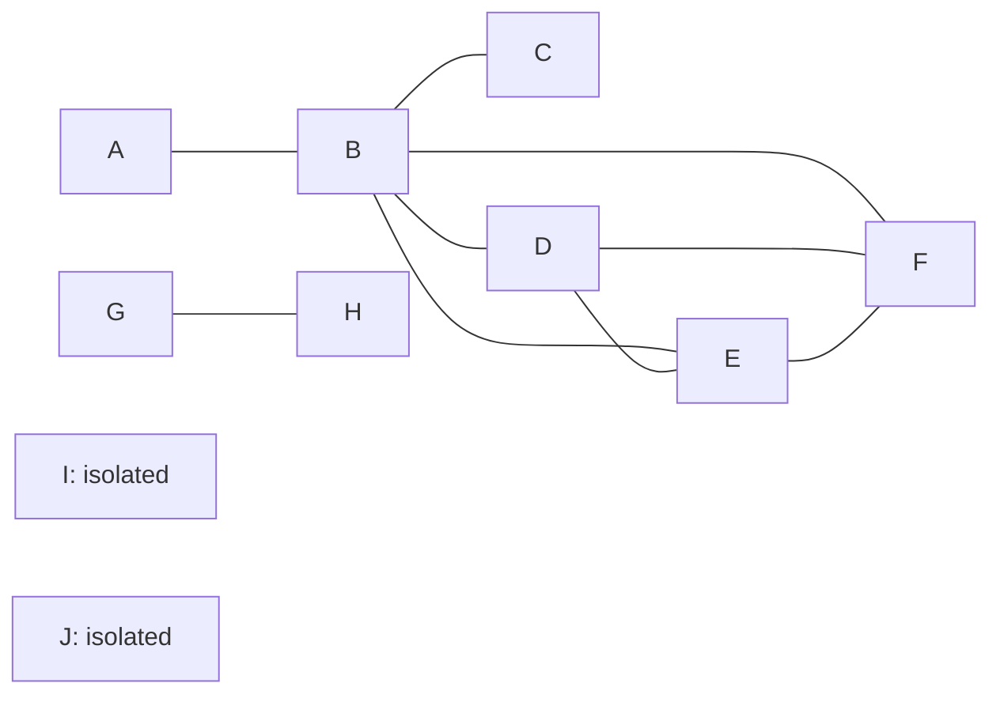
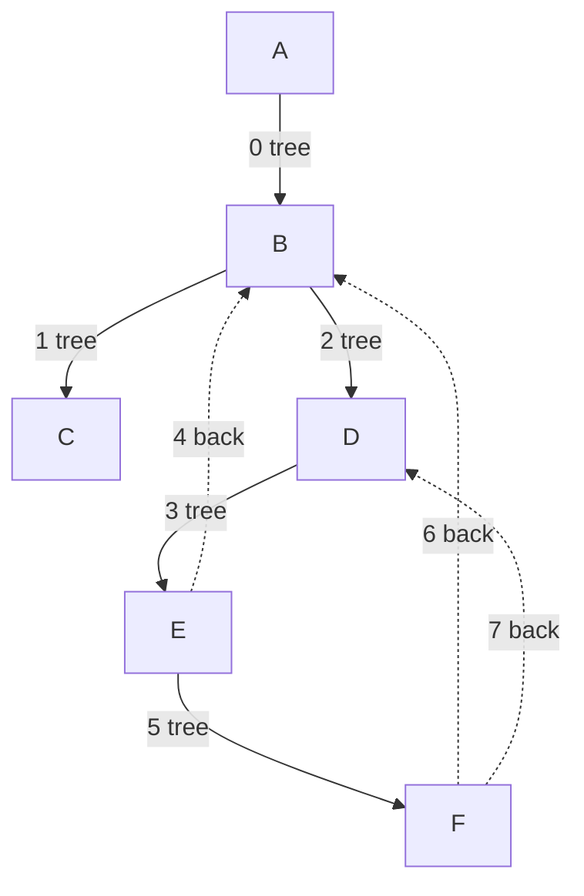
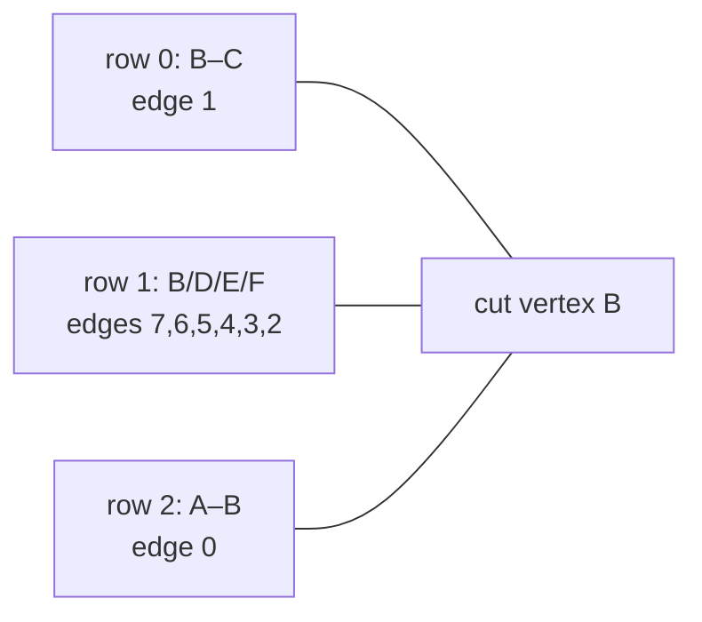

# Module 6 Graph DFS and Edge-Block Models

These models follow [lab.c](../student/lab.c). Every diagram has a text
representation. Edge indices describe the root-A run and its stored
adjacency order.

## Input graph

The input has ten vertices and nine undirected edges.



Text equivalent: A–B, B–C, B–D, B–E, B–F, D–E, D–F, E–F, G–H.
I/J have no edges. Connected groups: A–F, G–H, I, J.

Stored neighbor lists, with labels corresponding to indices 0–9:

```text
A:[B] B:[A,C,D,E,F] C:[B] D:[B,E,F] E:[B,D,F] F:[B,D,E]
G:[H] H:[G] I:[] J:[]
```

## DFS tree and back edges from A

The tree edges create new children. The back edges point toward already
entered non-parent ancestors. The arrow directions reflect processing;
the input remains undirected.



Text equivalent: tree edges 0:A→B, 1:B→C, 2:B→D, 3:D→E, 5:E→F;
back edges 4:E→B, 6:F→B, 7:F→D.
Discovery order: A/B/C/D/E/F. Low-link values: 1/2/3/2/2/2.
Parents by index: -1/0/1/1/3/4. G/H/I/J are not reached.

## Pending-edge stack

The explicit stack contains edge indices, bottom to top.

| Event | Stack | New block row |
| --- | --- | --- |
| enter B | `0` | none |
| enter C | `0,1` | none |
| finish C | `0` | `[1]` |
| enter D | `0,2` | none |
| enter E | `0,2,3` | none |
| E→B | `0,2,3,4` | none |
| enter F | `0,2,3,4,5` | none |
| F→B | `0,2,3,4,5,6` | none |
| F→D | `0,2,3,4,5,6,7` | none |
| finish F/E | unchanged | none |
| finish D | `0` | `[7,6,5,4,3,2]` |
| finish B | empty | `[0]` |
| finish A | empty | none |

At a non-root return, a low-link value below the parent's discovery
number keeps the suffix pending. Equality or a larger value pops through
the parent tree edge, inclusive.

## Blocks meet at B

The result partitions the eight reached edges into three groups. B is
shared; the edges are not shared.



Text equivalent: B–C and A–B are one-edge blocks. The middle block has all
six edges among B/D/E/F. All three blocks contain B. No other vertex is
shared between these blocks. A is a DFS root with one child and is not a
cut vertex. An isolated root emits no edge row.

## Preparation sequence

Each phase needs results from the preceding phase.

```text
initialize graph once
    → init_edges_list(root): reset visits, index edges
    → find_bcc(root): reset visits, save low-link values
    → reset top and visits, retaining low-link values
    → _find_bcc(root): push edges, pop blocks at postorder boundaries
```

Use the same root and unchanged lists in each pass. `find_bcc()` does not
reset `current_bcc`; the supplied use is a fresh one-call run. The complete
pipeline includes a V×V lookup reset even though traversal reads lists.
