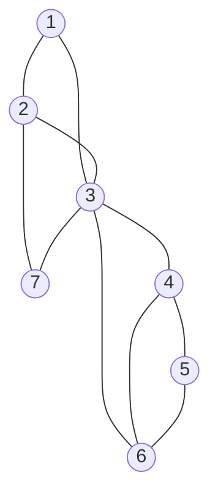
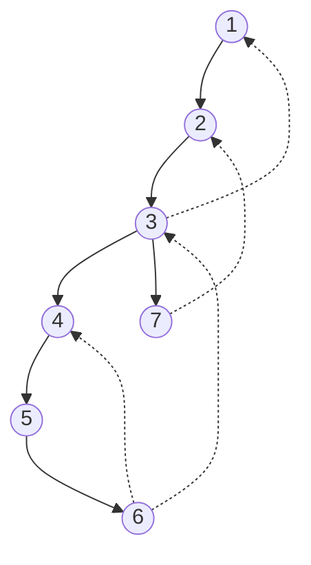
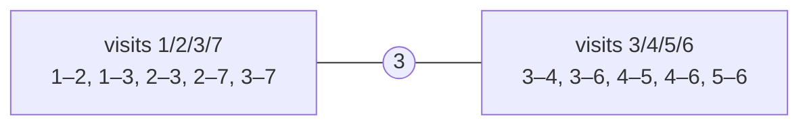

# Module 6 Graph DFS Models — Visit-numbered Slides and Coding Lab

Primary models follow [concept slides](../student/ppt_material.md).
The numbers 1–7 are the completed visit numbers of the fixed DFS.
Refer to vertices by these numbers and retrace from visit 1 with ascending
diagram neighbors. Concept stacks use endpoint visit pairs; every diagram
has a text equivalent. The final section separately records [lab.c](../student/lab.c).

## Completed visit-numbered diagram



Text equivalent: endpoint visit pairs 1–2, 1–3, 2–3, 2–7, 3–4, 3–6,
3–7, 4–5, 4–6, 5–6. Ascending diagram neighbors:

```text
1:[2,3] 2:[1,3,7] 3:[1,2,4,6,7]
4:[3,5,6] 5:[4,6] 6:[3,4,5] 7:[2,3]
```

Blank-circle slides ask students to fill visit numbers reached at a stage.
Partial highlights show handled connections; the underlying graph remains the same.

## Tree and back connections



Text equivalent: tree descent 1→2, 2→3, 3→4, 4→5, 5→6, 3→7;
back connections 3→1, 6→3, 6→4, 7→2. Arrows describe processing direction
between visits; the input graph is undirected.

| Encounter at visit 3 | Case |
| --- | --- |
| 1 | non-parent ancestor |
| 2 | parent |
| 4 | unexplored child |
| 6 after the 4 branch finishes | processed descendant |
| 7 | unexplored child |

Number at entry, set the child's parent before descent, resume the paused
scan after return, and use postorder after all neighbors.

```text
visit number  1 2 3 4 5 6 7
parent visit  – 1 2 3 4 5 3
earliest      1 1 1 3 3 3 2
```

Visit 6 begins at 6; connection 6→3 lowers it to 3. Connection 6→4 does
not lower 3. Child-return propagation carries 3 through visit 5 to visit 4.

## Three storage views

| View | Example pair 3–6 | Main access |
| --- | --- | --- |
| Neighbor lists | 6 in 3's list; 3 in 6's list | scan one vertex's neighbors |
| Endpoint-pair list | one pair 3–6 | keep separate connection records |
| Presence matrix | symmetric cells for endpoint visits 3/6 | direct pair lookup |

Adding/deleting a pair updates both directions in lists/matrices.
Deleting a vertex removes its incident connections from the rest of the
graph. Collection accepts only new child and non-parent ancestor encounters,
giving ten undirected pairs from twenty neighbor entries.

## Complete pending pairs: bottom → top

| Event | Complete stack | New group, removal order |
| --- | --- | --- |
| enter visit 2 | 1–2 | none |
| enter visit 3 | 1–2, 2–3 | none |
| 3 → 1 | 1–2, 2–3, 1–3 | none |
| enter visit 4 | 1–2, 2–3, 1–3, 3–4 | none |
| enter visit 5 | 1–2, 2–3, 1–3, 3–4, 4–5 | none |
| enter visit 6 | 1–2, 2–3, 1–3, 3–4, 4–5, 5–6 | none |
| 6 → 3 | 1–2, 2–3, 1–3, 3–4, 4–5, 5–6, 3–6 | none |
| 6 → 4 | 1–2, 2–3, 1–3, 3–4, 4–5, 5–6, 3–6, 4–6 | none |
| finish visit 6 | 1–2, 2–3, 1–3, 3–4, 4–5, 5–6, 3–6, 4–6 | none |
| finish visit 5 | 1–2, 2–3, 1–3, 3–4, 4–5, 5–6, 3–6, 4–6 | none |
| finish visit 4 | 1–2, 2–3, 1–3 | 4–6, 3–6, 5–6, 4–5, 3–4 |
| enter visit 7 | 1–2, 2–3, 1–3, 3–7 | none |
| 7 → 2 | 1–2, 2–3, 1–3, 3–7, 2–7 | none |
| finish visit 7 | 1–2, 2–3, 1–3, 3–7, 2–7 | none |
| finish visit 3 | 1–2, 2–3, 1–3, 3–7, 2–7 | none |
| finish visit 2 | empty | 2–7, 3–7, 1–3, 2–3, 1–2 |
| finish visit 1 | empty | none |

Earliest below the parent's visit number keeps pairs pending. Equality or
a larger value closes the group, including the parent–child boundary pair.
Here 3 ≥ 3 closes at 4→3 and 1 ≥ 1 closes at 2→1.

## Two blocks share visit 3



Text equivalent: two five-edge blocks share only visit 3 and no edge.
Each is maximal with two internally vertex-disjoint paths between every
pair. Removing that vertex leaves triangles on visits 1/2/7 and 4/5/6.
One connected vertex group contains two edge blocks. Peak calls follow
visits 1/2/3/4/5/6 (six); peak pending stack contains eight pairs.
The final slide asks for mini-quiz submission; use the workbook's classroom activity.

## Coding model: original A–J example

The [original driver](../code/lecture/lab_demo.c) includes the current
array lab and initializes the Chapter 3 graph:

```text
A–B, B–C, B–D, B–E, B–F, D–E, D–F, E–F, G–H
I/J isolated
A:[B] B:[A,C,D,E,F] C:[B] D:[B,E,F] E:[B,D,F] F:[B,D,E]
G:[H] H:[G] I:[] J:[]
```

A reaches A–F with discovery 1/2/3/4/5/6 and low 1/2/3/2/2/2.
In this coding example, indexed records are
0:A→B, 1:B→C, 2:B→D, 3:D→E, 4:E→B, 5:E→F, 6:F→B, 7:F→D.
Rows `[1]`, `[7,6,5,4,3,2]`, `[0]` have sizes 1/6/1 and share B.
G–H and isolated I/J are outside A's reach. These outputs do not describe
the new visit-numbered slide graph.

```text
initialize A–J once
 → init_edges_list(start_node): reset visits/count/lookup, index edges
 → find_bcc(start_node): reset visits and save low-link values
 → reset top and visits, retaining saved low-link values
 → _find_bcc(start_node): push indices; parent compares immediately after each child returns
 → close_bcc(tree_edge): pop the boundary-inclusive suffix when the comparison closes a block
```

The same starting vertex and unchanged lists reproduce discovery numbers.
`find_bcc()` does not reset `current_bcc`; use a fresh one-call process.
The wrapper sequence performs three DFS passes: indexing, low-link
calculation, and extraction. The current lab reserves 45 edge records,
nine result rows of 45 entries, and nine row lengths; the reused stack
still holds only ten pending edge indices.
The optional [slide driver](../code/lecture/ppt_demo.c) stores neutral A–G
data at internal indices 0–6, then prints endpoint visit numbers 1–7 from
actual traversal results. It does not change the original A–J initializer.
