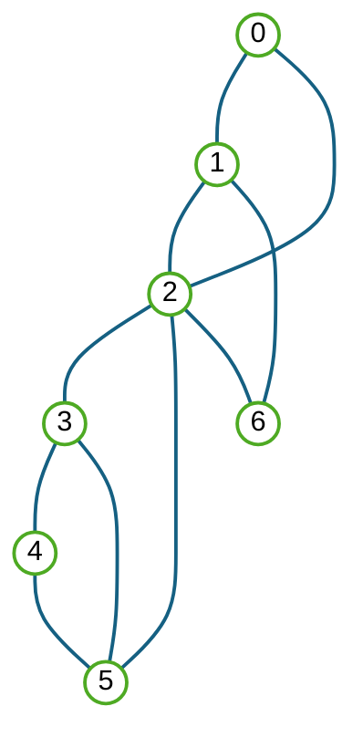
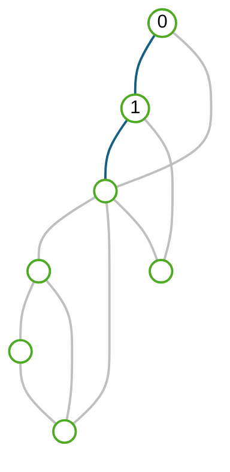

# 오늘의 목차

# 복습 - 간선의 구성 요소

# 복습 - 노드의 이웃 리스트

# 복습 - 그래프에서 반복하는 방법

# 복습 - DFS 트리 간선과 빽간선

# 복습 - 트리 방문 번호와 빽번호

# 이웃 간선의 종류는?

# 다음 그래프에서 간선의 종류는?

# 이웃 노드의 종류는?

# 2번 노드 이웃의 종류는?

# 트리 간선 자식 노드의 특징은?

# 빽 간선 후손 노드의 특징은?

# 빽 간선 조상 노드의 특징은?

# 트리 간선 부모 노드의 특징은?

# 이웃 노드를 구별하는 방법은?

# 2번 노드 이웃을 구별하면?

# 그래프 탐색의 작업 타이밍은?

# preorder에서 항상 하는 일은?

# 트리 간선 자식에 항상 하는 일은?

# 2번 노드에서 진행되는 작업은?

# 간선을 저장하는 세가지 방법은?

# 간선 리스트를 만들면 좋은점은?

# 이웃 행렬을 만들면 좋은 점은?

# 리스트, 행렬에 간선을 추가하려면?

# 간선 추가 작업을 할 대상 이웃은?

# 그래프의 간선 리스트를 만들면?

# 복습 - 빽번호란?

# 복습 - 5번 노드의 빽번호는 ?

# 복습 - 끈끈한 그래프란?

# 복습 - 여기서 끈끈한 그래프는?

# 복습 - 빽번호로 끈끈한 간선 찾기

# 복습 - 끈끈한 간선을 찾으면?

# 끈끈한 간선 찾을 때 스택의 용도?

# 끈끈한 간선 찾을 때 스택의 변화?

# 트리 간선 자식에서 할 일은?

# 빽 간선 조상에서 할 일은?

# postorder에서 할 일은?

# 끈끈한 간선을 찾는 과정?

# 2025 중간고사 기출문제

- 그래프에 노드나 간선을 저장하고, 추가하고, 삭제하는 방법 설명하기

- 끈끈한 그래프의 정의와 찾는 방법 설명하기

# 2025 중간고사 기출문제

- 그래프에 노드나 간선을 저장하고, 추가하고, 삭제하는 방법 설명하기

- 끈끈한 그래프의 정의와 찾는 방법 설명하기

- preorder, inorder로 트리 복원하기
