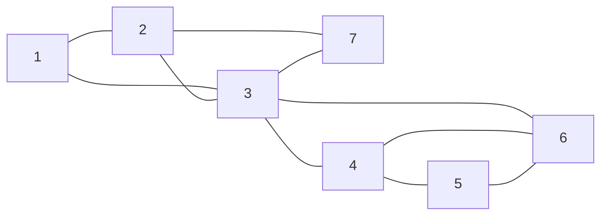

# Chapter 6. Grouping connections in a graph

We will explore a graph and record each connection once. Then we will use a stack to group the connections according to how the graph holds together.

## Thinking logically

### How do we store connections in a graph?

An undirected edge connects two vertices. In Chapter 3, we stored each vertex's neighbors in an adjacency list. Each edge appears in both endpoint lists, so either vertex can find the other.

Here we introduce two more representations. An edge list stores one pair of endpoints per connection. An adjacency matrix stores whether each pair of vertices is directly connected. The list lets us work with edges as individual items; the matrix lets us check a specified pair directly.

### How do we explore without repeating work?

Give a vertex a positive visit number when first entering it. Zero means it has not been reached. Continue through an unreached neighbor, finish that neighbor's exploration, then resume the current vertex's neighbor list. This is depth-first search (DFS).

The vertex that first discovers another vertex becomes its DFS parent. The starting vertex is the root and has no parent. A visit number describes discovery order; it is different from the vertex's array index.

### What graph will we explore?

Let's consider this graph. The numbers identify vertices by their visit numbers in the completed DFS. During exploration, a vertex receives its number only when first reached.



Start at vertex 1 and read each neighbor list in ascending order of these completed numbers. Follow 1, 2, 3, 4, 5, and 6. After returning to 3, explore 7. All seven vertices are reached, so the graph has one connected component.

### How do we distinguish the neighbors?

An edge to an unreached neighbor becomes a tree edge: it discovers a child. When the child sees its parent in its own list, skip that reverse entry of the same edge.

For another reached neighbor, compare visit numbers. A smaller number identifies an ancestor, and the edge toward it is a back edge. A larger number identifies a descendant that has already processed the connection, so skip that reverse entry too.

At vertex 3, the five neighbors need different actions:

| Neighbor | Case when examined | Action |
| --- | --- | --- |
| 1 | Ancestor other than the parent | Process back edge 3 → 1 |
| 2 | Parent | Skip the reverse tree edge |
| 4 | Unreached vertex | Record its parent and explore it |
| 6 | Descendant reached through 4 and 5 | Skip the connection already processed as 6 → 3 |
| 7 | Unreached vertex | Record its parent and explore it |

These rules assume a simple undirected graph: no edge joins a vertex to itself, and no pair has more than one edge. Directed graphs and parallel edges need different rules.

### When do we perform each task?

Assign the visit number on entry, at preorder. Process a tree edge before entering its child, and process a back edge when examining its ancestor. After a child returns, use the result of that finished branch before moving to the next neighbor.

Postorder is after all the current vertex's neighbors finish, just before returning to its parent. As in Chapter 5, each recursive call waits for its children. A graph has no fixed left and right child positions, so it has no single inorder position.

### How do we record each edge and find it again?

Record a tree edge before exploring its child. Record a back edge from descendant to ancestor. Skipping the reverse entries gives one record per undirected edge.

In our example, the recording order is `1→2, 2→3, 3→1, 3→4, 4→5, 5→6, 6→3, 6→4, 3→7, 7→2`. The arrows describe how we record the edges; the connections remain undirected.

Keep a table that maps both endpoint orders to the same edge index. Looking up 3–6 or 6–3 finds the same record. Use `-1` when no record exists, because zero is a valid edge index. This lookup answers which record represents a connection; an adjacency matrix answers whether the connection exists. An edge outside the explored component has no record in this pass.

### How do we add or remove a connection?

Adding an undirected edge changes both endpoint neighbor lists and both symmetric adjacency-matrix cells. An edge list needs one new record. Removing the edge reverses those changes; if records move, update the lookup indices.

A new vertex needs a neighbor list and a matrix row and column. Removing a vertex also removes its incident edges and all references to it. After changing the graph, run DFS afresh because its visit numbers and parents may change. The code below provides sample initialization and exploration, rather than a general editing interface.

### How far back can a finished branch reconnect?

For each vertex, remember the earliest visit number reachable by going down zero or more tree edges and then using at most one back edge. Include the vertex's own number as a candidate. This is its low-link value.

Start with the vertex's visit number. After a child finishes, keep the smaller of the current value and the child's low-link value. A back edge supplies its ancestor's visit number. Skip the parent edge.

| Vertex's visit number | Parent's visit number | Low-link value |
| --- | --- | --- |
| 1 | none | 1 |
| 2 | 1 | 1 |
| 3 | 2 | 1 |
| 4 | 3 | 3 |
| 5 | 4 | 3 |
| 6 | 5 | 3 |
| 7 | 3 | 2 |

Vertex 6 connects back to ancestors 3 and 4, so its low-link value is 3. That value returns through vertices 5 and 4. Vertex 7 connects back to 2. Vertex 3 itself connects back to 1, so its value and vertex 2's value are both 1.

### What groups do we want to find?

Removing vertex 3 separates vertices 1/2/7 from vertices 4/5/6. We want the largest groups whose remaining vertices stay connected after any one vertex in the group is removed. These groups are biconnected components (BCCs), also called blocks.

For a block with at least three vertices, every pair has two paths that share only their endpoints. For example, 3–6 and 3–4–6 share no internal vertex. We call such paths internally vertex-disjoint. The property must hold for every pair, and the group must be maximal.

Our graph has two blocks: the five edges among 3/4/5/6 and the five edges among 1/2/3/7. They share vertex 3, a cut vertex, but share no edge. A bridge, whose removal disconnects its endpoints, forms a single-edge block. An isolated vertex has no edge for this algorithm to group.

### How does a stack help us find the blocks?

Push a tree edge before entering its child. Push a back edge when examining it toward an ancestor. These edges wait on the stack until we know which block contains them. The recursive calls remember unfinished vertex scans; the edge stack remembers unfinished grouping work.

After a child finishes, compare its low-link value with its parent's visit number.

- If the child's value is smaller, its branch reconnects above the parent. Leave the edges pending.
- Otherwise, the branch cannot reconnect above the parent. Pop edges through the parent-to-child tree edge, including that edge. They form one block.

Equality closes a block. Vertex 4's branch reaches parent 3 through 6 → 3, but cannot reach an earlier ancestor. Its low-link value 3 equals its parent's visit number 3.

### How are the two blocks found?

Let's follow the pending edges from the bottom of the stack to the top.

1. Explore through vertex 6 and process its back edges. The stack holds `1–2, 2–3, 1–3, 3–4, 4–5, 5–6, 3–6, 4–6`.
2. Return through vertices 5 and 4. Low-link value 3 is smaller than parent visit numbers 5 and 4, so those returns leave the edges pending.
3. Return from 4 to 3. Now the values are equal. Pop through 3–4, producing the block `4–6, 3–6, 5–6, 4–5, 3–4`. The first three edges remain pending.
4. Explore 7 from 3 and process 7 → 2. The stack becomes `1–2, 2–3, 1–3, 3–7, 2–7`. Returns from 7 to 3 and from 3 to 2 leave these edges pending.
5. Return from 2 to 1. Low-link value 1 equals parent visit number 1. Pop through 1–2, producing the block `2–7, 3–7, 1–3, 2–3, 1–2`.

The stack is empty, and each of the ten edges belongs to exactly one block. The root has no incoming edge of its own; it checks each finished child by the same rule. Here it has one DFS child, vertex 2, and is not a cut vertex.

## Calculating efficiency

### Memory efficiency for storing

Neighbor lists use space proportional to the vertices and edges. An edge list stores two endpoint indices per edge. An adjacency matrix or edge lookup reserves one cell per ordered vertex pair, so its space grows with the square of the number of vertices.

The lab reserves ten vertices with ten neighbor positions each, `edges[45]`, and `edge_index[10][10]`. Results use `bcc[9][45]` and `bcc_size[9]`. These arrays reserve all their cells even when only some are used. Ten vertices allow at most 45 simple undirected edges and at most nine edge blocks.

### Memory efficiency for iterating over items

Each active recursive call keeps its position in a neighbor list. At most, there is one active call per reached vertex. The separate edge stack can need space for every reached edge. Each edge appears once in the completed results, although the rectangular result array reserves extra cells.

Our seven-vertex example uses at most six active calls and eight pending edges. The lab's `stack[10]` has only ten slots; having room for 45 edge records does not make the stack larger.

### Efficiency of creating or adding one item

Writing one edge record and its two lookup cells takes constant time when space is available. Appending to both endpoint neighbor lists and changing both matrix cells also takes constant time with available storage. Initializing an entire matrix row and column for a new vertex takes work proportional to the number of vertices.

### Efficiency of iterating over items

Let `R` be the number of reached vertices and `E_R` the number of edges in that component. One DFS takes `O(R + E_R)` time: it enters each vertex once and reads both neighbor entries of each edge. Each edge is also pushed and popped once during grouping.

We use three passes: record edges, save low-link values, and group edges. Our example therefore has 21 vertex entries and 60 neighbor inspections. Preparing the lookup for `V` vertices takes `O(V²)` time, so the complete method takes `O(V² + E_R)` time. Each pass explores only the starting component.

## Glossary

### Depth-first search (DFS)

Exploring an unreached neighbor completely before resuming the current vertex's remaining neighbors.

### Visit number (discovery number)

A positive number assigned on first entry to a vertex; zero means unvisited.

### DFS parent

The vertex that first discovers a child. A root has no parent.

### Tree edge

An edge used to discover an unreached vertex.

### Back edge

In this simple undirected DFS, a non-parent edge from a descendant to an ancestor.

### Preorder processing

Work performed on first entering a vertex.

### Postorder processing

Work performed after all the current vertex's neighbors finish.

### Low-link value

The earliest visit number reachable by tree descent followed by at most one back edge, including the current vertex itself.

### Connected component

A maximal group of vertices joined by undirected paths.

### Adjacency list

A vertex's collection of neighbors.

### Edge list

A collection of endpoint pairs, with one record per undirected edge.

### Adjacency matrix

A table recording whether each pair of vertices is directly connected.

### Edge lookup

A symmetric table mapping both endpoint orders to the same edge record.

### Internally vertex-disjoint paths

Paths whose only shared vertices are their two endpoints.

### Biconnected component (block)

A maximal connected group with no separating vertex within the group. A bridge also forms a single-edge block.

### Cut vertex (articulation point)

A vertex whose removal increases the number of connected components.

### Bridge

An edge whose removal increases the number of connected components.

### Pending-edge stack

Edges already handled but not yet assigned to a block, stored in last-in, first-out order.

## Invariant

### What are the invariants (the golden rules) in this data structure?

- Each reached undirected edge has one record. Both endpoint orders find that record; `-1` means no record in this pass.
- After each push or completed pop-and-store step, every handled edge appears exactly once: either pending on the stack or assigned to output, including a row still being filled.
- At a non-root vertex's postorder, the pending suffix from its incoming parent edge through the stack's top contains only edges in that incoming edge's eventual block. Other edges from its branch have already been assigned.
- The low-link and grouping passes use the same starting vertex and neighbor order, so saved values describe the same DFS branches.

### What is the benefit of the invariants?

The accounting rule gives `handled edges = pending edges + assigned edges`, with matching identities and no repeated edge. The postorder rule explains which edges can wait together. A child branch that cannot reconnect above the current vertex has already closed; a branch that can reconnect stays with the current vertex's incoming edge.

At vertex 4's postorder, the pending suffix is `3–4, 4–5, 5–6, 3–6, 4–6`. All five belong with 3–4. The parent at vertex 3 then closes that block. Older edges below the suffix can belong to other blocks; a suffix need not contain its entire eventual block until the closing boundary is reached.

### What happens if an invariant is broken?

Recording both directions duplicates an edge. Omitting the boundary edge from a pop leaves it for the wrong block. Popping too far mixes blocks. Changing DFS order after saving low-link values can make the boundary comparison use a summary from a different branch.

An empty final stack alone does not prove correctness: an edge could have been lost or stored twice. Invalid indices or writes beyond the arrays also break the storage assumptions.

### How do we keep the invariants intact?

Initialize before exploring. Handle each tree edge and ancestor back edge once, skip their reverse entries, and transfer every popped edge into its result row. Include the boundary edge and save the row's length only after it is complete.

Start grouping with an empty edge stack and fresh visit state, while keeping the saved low-link values. At the root's postorder, every reached edge has been assigned and the stack is empty. The lab assumes valid indices, symmetric neighbor lists, and enough capacity; its edge and stack helpers do not check these conditions.

## Coding plan

### Preparing the graph

Reuse the graph arrays from Chapter 3 and the integer stack from Chapter 4. Store vertex indices in `parent`, discovery numbers in `visit_num`, and low-link values in `back_num`.

The supplied initializers build a separate alphabet graph with vertices A–J and edges A–B, B–C, B–D, B–E, B–F, D–E, D–F, E–F, and G–H. I and J are isolated. Starting at A reaches only A–F. This graph has four connected components; it is different from the seven-vertex example above.

### Recording the edges

1. Reset the visit counter and visit numbers, and set every parent to `-1`.
2. Clear the edge count and fill the active lookup cells with `-1`.
3. Record each tree edge before entering its child and each back edge toward an ancestor. Store the record's index in both lookup directions.

### Saving low-link values

Start a fresh DFS from the same root. Give each vertex its discovery number as its initial low-link value. Keep smaller values from finished children and non-parent ancestor connections.

### Grouping pending edges

1. Empty the stack and reset visit state without clearing `back_num`.
2. Explore with the same root and neighbor order, pushing tree edges and ancestor back edges.
3. After a child returns, close a block if `back_num[child] >= visit_num[parent]`. Pop through that child's tree edge, including it.

### Reading the blocks

Each row of `bcc` contains edge indices, and `bcc_size` gives its active length. Resolve each index through `edges` to find the endpoints.

Call `init_edges_list(start_node)` before `find_bcc(start_node)` on the unchanged graph. Neither wrapper searches other components. The supplied `find_bcc()` is used once in a fresh program: it does not clear `current_bcc` or the result rows. Repeated calls need explicit result management, and rebuilding the edge list changes the meaning of saved edge indices.

## New C syntax explained

### Two-dimensional arrays

`int edge_index[10][10];` declares ten rows of ten integers. `edge_index[u][v]` selects row `u`, then column `v`. In `bcc[row][pos]`, the stored integer is an edge index, not a vertex index.

### Prefix and postfix increment

`++visit_time` increases the counter before supplying its value, so the first visit number is 1. `edges_size++` supplies the old value and then increases the count, so the first edge index is 0. Likewise, `bcc[cur][pos++]` writes at the current position and then advances it.

### Chained assignment

`back_num[i] = visit_num[i] = ++visit_time;` increments the counter once and assigns that number to both array entries.

### `continue`

`continue;` skips the rest of the current loop iteration. In `_find_bcc()`, it leaves the child's edges pending and advances to the next neighbor; it does not return from the function.

### `do ... while`

A `do` loop runs its body before checking the condition. `close_bcc()` must pop at least one edge and stop only after storing the boundary edge. The final semicolon after `while (...)` is required. Declare `edge` before the loop so its condition can read the value.

### Including another source file

`#include "..."` inserts the named file before compilation. This lab includes the earlier graph and stack sources, so their functions and globals are already available. Compile with the repository root on the include path using `-I.` when working from that root.

## C code

### Reusing graph and stack storage

```c
#include "module_03_graph/student/lab.c"
#include "module_04_stack/student/lab.c"
```

### Resetting visit state

```c
void init_visit() {
        visit_time = 0;
        for (int i = 0; i < nodes_size; i++) {
                visit_num[i] = 0; // Zero means not yet reached in this pass.
                parent[i] = -1; // A root keeps this no-parent marker.
        }
        // Keep back_num: grouping will use the summaries from the previous pass.
}
```

### Classifying neighbors

This template shows where edge actions belong. It only assigns visit numbers and parents; the later functions add recording and grouping work.

```c
void _edge_iteration_(int node) {
        visit_num[node] = ++visit_time; // Preorder: discover this vertex.
        for (int i = 0; i < nodes[node].adj_size; i++) {
                int adj = nodes[node].adj_list[i];
                if (visit_num[adj] == 0) {
                        // A tree edge discovers a child; process it before recursion.
                        parent[adj] = node;
                        _edge_iteration_(adj);
                }
                else if (adj == parent[node]) {
                        // Skip the reverse of the incoming tree edge.
                }
                else if (visit_num[adj] < visit_num[node]) {
                        // Process a back edge toward an ancestor without recursion.
                }
                else if (visit_num[adj] > visit_num[node]) {
                        // The descendant already processed this connection.
                }
                else {
                        // A self-loop is outside our simple-graph example.
                }
        }
        // Postorder: every neighbor and child branch has finished.
}
```

### Storing edge records

```c
struct GraphEdge {
        int from, to; // Endpoint array indices, not visit numbers.
};
struct GraphEdge edges[45];
int edges_size = 0;
int edge_index[10][10] = {0}; // The wrapper replaces active cells with -1.
```

### Adding one edge record

```c
void add_edge(int u, int v) {
        // Requires an unrecorded edge and an available array slot.
        int index = edges_size++;
        edges[index].from = u;
        edges[index].to = v;
        // Either endpoint order finds this same undirected edge.
        edge_index[u][v] = index;
        edge_index[v][u] = index;
}
```

### Recording reached edges

```c
void _init_edges_list(int node) {
        visit_num[node] = ++visit_time;
        for (int i = 0; i < nodes[node].adj_size; i++) {
                int adj = nodes[node].adj_list[i];
                if (visit_num[adj] == 0) {
                        add_edge(node, adj); // Record the tree edge before entering its child.
                        parent[adj] = node;
                        _init_edges_list(adj);
                }
                else if (adj == parent[node]) {
                        // The parent already recorded this tree edge.
                }
                else if (visit_num[adj] < visit_num[node]) {
                        add_edge(node, adj); // Record the back edge toward its ancestor.
                }
                else if (visit_num[adj] > visit_num[node]) {
                        // The descendant already recorded this back edge.
                }
                else {
                        // Self-loops are not recorded.
                }
        }
}
```

### Preparing the edge lookup

```c
void init_edges_list(int start_node) {
        init_visit();
        edges_size = 0;
        for (int i = 0; i < nodes_size; i++) {
                for (int j = 0; j < nodes_size; j++) {
                        // Zero is a valid edge index; -1 means no record.
                        edge_index[i][j] = -1;
                }
        }
        _init_edges_list(start_node); // Record only the starting component.
}
```

### Saving low-link values

This function is already included from Chapter 3. It is shown here for review; do not define it a second time when assembling the snippets.

```c
void save_back_num(int i) {
        back_num[i] = visit_num[i] = ++visit_time;
        for (int j = 0; j < nodes[i].adj_size; j++) {
                int adj = nodes[i].adj_list[j];
                if (visit_num[adj] == 0) {
                        parent[adj] = i;
                        save_back_num(adj);
                        // Use the child's completed summary after it returns.
                        if (back_num[i] > back_num[adj]) {
                                back_num[i] = back_num[adj];
                        }
                } else if (adj != parent[i]) {
                        // An ancestor can lower the value; a later descendant cannot.
                        if (back_num[i] > visit_num[adj]) {
                                back_num[i] = visit_num[adj];
                        }
                }
        }
}
```

### Storing a completed block

```c
int bcc[9][45]; // Each row holds the edge indices belonging to one block.
int bcc_size[9] = {0};
int current_bcc = 0;

void close_bcc(int boundary_edge) {
        int cur = current_bcc++; // Open the next result row.
        int pos = 0;
        int edge;
        do {
                // The boundary edge must still be on this nonempty stack.
                edge = pop();
                bcc[cur][pos++] = edge; // Complete the transfer from pending to assigned.
        } while (edge != boundary_edge); // Store the boundary edge too.
        bcc_size[cur] = pos; // Publish the length only after the row is complete.
}
```

### Grouping pending edges

```c
void _find_bcc(int node) {
        visit_num[node] = ++visit_time;
        for (int i = 0; i < nodes[node].adj_size; i++) {
                int adj = nodes[node].adj_list[i];
                if (visit_num[adj] == 0) {
                        int tree_edge = edge_index[node][adj];
                        push(tree_edge); // Keep the incoming edge below its child's pending edges.
                        parent[adj] = node;
                        _find_bcc(adj);
                        // The child's entire branch is finished before this comparison.
                        if (back_num[adj] < visit_num[node]) {
                                continue; // It reconnects above this parent, so leave it pending.
                        }
                        close_bcc(tree_edge); // Equality or a larger value closes the block.
                }
                else if (adj == parent[node]) {
                        // Skip the reverse tree edge.
                }
                else if (visit_num[adj] < visit_num[node]) {
                        int back_edge = edge_index[node][adj];
                        push(back_edge); // Push a back edge only from descendant to ancestor.
                }
                else if (visit_num[adj] > visit_num[node]) {
                        // The descendant already pushed this edge.
                }
                else {
                        // Self-loops are not grouped.
                }
        }
        // A non-root's pending suffix now belongs with its incoming parent edge.
}
```

### Preparing the grouping passes

```c
void find_bcc(int start_node) {
        // Called once after init_edges_list(), with unchanged root and neighbor order.
        init_visit();
        save_back_num(start_node);
        top = -1; // Begin with no pending edges.
        init_visit(); // Reset discovery and parents, preserving back_num.
        _find_bcc(start_node);
        // current_bcc and result rows are not reset by this wrapper.
}
```

### Running the alphabet example

The lab has no `main()`. In a fresh program, call these functions in order:

```c
alphabet_nodes_init(); // Prepare A-J with empty neighbor lists.
edges_init(); // Append each supplied edge to both endpoint lists, once.
init_edges_list(0); // Index the component containing A at array index 0.
find_bcc(0);
```

The eight records are A→B, B→C, B→D, D→E, E→B, E→F, F→B, and F→D. For example, `edge_index[1][4]` and `edge_index[4][1]` are both 4, the B–E record. G–H is unreached, so its lookup remains `-1`.

The resulting rows are `[1]`, `[7, 6, 5, 4, 3, 2]`, and `[0]`: the single edge B–C, the six edges among B/D/E/F, and the single edge A–B. Thus `edges_size` is 8, `current_bcc` is 3, the row sizes are 1/6/1, and `top` is `-1`.

Read only rows below `current_bcc` and entries below each `bcc_size[row]`. For A–F, visit numbers are 1/2/3/4/5/6 and low-link values are 1/2/3/2/2/2. G/H/I/J remain unvisited.

The [alphabet driver](../code/lecture/lab_demo.c) runs this sequence. The [seven-vertex driver](../code/lecture/ppt_demo.c) supplies the earlier conceptual graph instead and produces two five-edge blocks, with edge-index rows `[7, 6, 5, 4, 3]` and `[9, 8, 2, 1, 0]`. Its array indices are 0–6; its displayed visit numbers are 1–7. Run both from the repository root:

```sh
make -C module_06_graph_dfs/code lecture lecture-ppt
```
