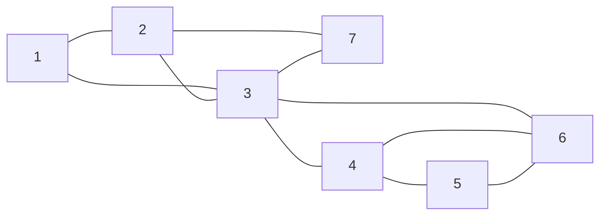

# 제6장. 그래프의 연결을 그룹으로 묶기

그래프를 탐색하며 각 연결을 한 번씩 기록한다. 그런 다음 스택을 사용해 그래프의 연결 구조에 따라 간선들을 그룹으로 묶는다.

## 논리적으로 생각해 보기

### 그래프의 연결을 어떻게 저장할까?

무방향 간선은 두 노드를 연결한다. 3장에서는 각 노드의 이웃을 인접 리스트에 저장했다. 간선마다 양 끝점의 목록에 항목이 하나씩 있으므로 어느 쪽 노드에서든 상대를 찾을 수 있다.

여기서는 두 가지 표현을 더 소개한다. 간선 리스트는 연결마다 양 끝점의 쌍을 하나씩 저장한다. 인접 행렬은 각 노드 쌍이 직접 연결되어 있는지 저장한다. 간선 리스트를 사용하면 간선을 개별 항목으로 다룰 수 있고, 인접 행렬을 사용하면 지정한 노드 쌍의 연결 여부를 바로 확인할 수 있다.

### 같은 작업을 반복하지 않고 어떻게 탐색할까?

노드에 처음 들어갈 때 양수인 방문 번호를 부여한다. 0은 아직 도달하지 않았다는 뜻이다. 도달하지 않은 이웃으로 들어가 그 이웃의 탐색을 끝낸 뒤, 현재 노드의 이웃 목록을 계속 읽는다. 이것이 깊이 우선 탐색(DFS)이다.

다른 노드를 처음 발견한 노드가 그 노드의 DFS 부모가 된다. 시작 노드는 root이며 부모가 없다. 방문 번호는 발견 순서를 나타내며, 노드의 배열 인덱스와는 다르다.

### 어떤 그래프를 탐색할까?

다음 그래프를 생각해보자. 숫자는 완료된 DFS의 방문 번호로 노드를 구별한다. 실제 탐색에서는 각 노드에 처음 도달할 때에만 번호를 부여한다.



노드 1에서 시작하고, 각 이웃 목록을 완료된 방문 번호의 오름차순으로 읽는다. 1, 2, 3, 4, 5, 6 순서로 따라간다. 3으로 돌아온 뒤에는 7을 탐색한다. 일곱 노드에 모두 도달하므로 이 그래프의 연결 요소는 하나다.

### 이웃들을 어떻게 구별할까?

아직 도달하지 않은 이웃으로 가는 간선은 자식을 발견하는 트리 간선이 된다. 자식이 자신의 목록에서 부모를 만나면 같은 간선의 반대 방향 항목을 건너뛴다.

이미 도달한 다른 이웃은 방문 번호를 비교한다. 번호가 더 작으면 조상이며, 그 조상으로 향하는 간선은 빽 간선이다. 번호가 더 크면 이 연결을 이미 처리한 자손이므로 그 반대 방향 항목도 건너뛴다.

노드 3의 이웃 다섯 개는 서로 다른 처리가 필요하다.

| 이웃 | 확인할 때의 경우 | 처리 |
| --- | --- | --- |
| 1 | 부모가 아닌 조상 | 빽 간선 3 → 1을 처리한다. |
| 2 | 부모 | 트리 간선의 반대 방향 항목을 건너뛴다. |
| 4 | 아직 도달하지 않은 노드 | 부모를 기록하고 탐색한다. |
| 6 | 4와 5를 거쳐 도달한 자손 | 6 → 3으로 이미 처리한 연결을 건너뛴다. |
| 7 | 아직 도달하지 않은 노드 | 부모를 기록하고 탐색한다. |

이 규칙은 단순 무방향 그래프를 가정한다. 자기 자신을 연결하는 간선이 없고, 같은 노드 쌍을 잇는 간선도 하나를 넘지 않는다. 방향 그래프나 같은 두 노드 사이의 중복 간선에는 다른 규칙이 필요하다.

### 각 작업은 언제 할까?

노드에 들어가는 preorder에서 방문 번호를 부여한다. 트리 간선은 자식으로 들어가기 전에 처리하고, 빽 간선은 조상을 확인할 때 처리한다. 자식이 돌아오면 다음 이웃으로 넘어가기 전에 끝난 가지의 결과를 사용한다.

postorder는 현재 노드의 모든 이웃 탐색이 끝나고 부모에게 돌아가기 직전이다. 5장과 마찬가지로 각 재귀 호출은 자식 호출을 기다린다. 그래프에는 정해진 왼쪽·오른쪽 자식 위치가 없으므로 하나로 정해진 inorder 위치도 없다.

### 각 간선을 한 번 기록하고 다시 찾으려면 어떻게 할까?

트리 간선은 자식을 탐색하기 전에 기록한다. 빽 간선은 자손에서 조상으로 읽을 때 기록한다. 반대 방향 항목을 건너뛰면 무방향 간선마다 기록이 하나씩 생긴다.

예제의 기록 순서는 `1→2, 2→3, 3→1, 3→4, 4→5, 5→6, 6→3, 6→4, 3→7, 7→2`다. 화살표는 간선을 기록하는 방향을 나타낸다. 연결 자체에는 여전히 방향이 없다.

양 끝점을 어느 순서로 넣어도 같은 간선 인덱스를 찾는 표를 둔다. 3–6으로 찾든 6–3으로 찾든 같은 기록에 도달한다. 0은 유효한 간선 인덱스이므로 기록이 없을 때는 `-1`을 사용한다. 이 표는 연결이 어느 기록인지를 알려 주고, 인접 행렬은 연결이 존재하는지를 알려 준다. 탐색한 연결 요소 밖의 간선은 이번 탐색의 기록에 없다.

### 연결을 어떻게 추가하거나 제거할까?

무방향 간선을 추가하면 양 끝점의 이웃 목록과 인접 행렬의 대칭인 두 칸을 바꾼다. 간선 리스트에는 새 기록 하나가 필요하다. 간선을 제거할 때는 이 변경을 되돌린다. 기록의 위치가 이동하면 찾기 표의 인덱스도 바꾼다.

새 노드에는 이웃 목록 하나와 행렬의 행·열이 하나씩 필요하다. 노드를 제거하면 그 노드에 연결된 간선과 그 노드를 가리키는 모든 참조도 제거한다. 그래프를 바꾼 뒤에는 방문 번호와 부모가 달라질 수 있으므로 DFS를 새로 실행한다. 아래 코드는 예제 초기화와 탐색을 제공하며, 일반적인 편집 인터페이스를 제공하지는 않는다.

### 끝난 가지는 얼마나 앞선 조상으로 돌아갈 수 있을까?

각 노드에서 트리 간선을 0개 이상 따라 내려간 뒤 빽 간선을 최대 하나 사용해 도달할 수 있는 가장 작은 방문 번호를 기억한다. 현재 노드 자신의 번호도 후보에 포함한다. 이 값이 빽 번호(low-link value)다.

노드 자신의 방문 번호로 시작한다. 자식의 탐색이 끝나면 현재 값과 자식의 빽 번호 중 작은 값을 유지한다. 빽 간선은 그 조상의 방문 번호를 후보로 제공한다. 부모 간선은 건너뛴다.

| 노드의 방문 번호 | 부모의 방문 번호 | 빽 번호 |
| --- | --- | --- |
| 1 | 없음 | 1 |
| 2 | 1 | 1 |
| 3 | 2 | 1 |
| 4 | 3 | 3 |
| 5 | 4 | 3 |
| 6 | 5 | 3 |
| 7 | 3 | 2 |

노드 6은 조상 3과 4로 돌아갈 수 있으므로 빽 번호가 3이다. 이 값은 노드 5와 4를 거쳐 돌아간다. 노드 7은 2로 돌아갈 수 있다. 노드 3 자체는 1로 돌아갈 수 있으므로 노드 3과 노드 2의 빽 번호는 모두 1이다.

### 어떤 그룹을 찾으려는 것일까?

노드 3을 제거하면 노드 1/2/7과 노드 4/5/6이 분리된다. 그룹 안의 어느 노드 하나를 제거해도 나머지 노드들이 연결되어 있는 가장 큰 그룹을 찾으려 한다. 이 그룹을 이중 연결 요소(biconnected component, BCC), 또는 블록(block)이라고 한다.

노드가 세 개 이상인 블록에서는 어느 노드 쌍이든 양 끝점만 공유하는 경로가 두 개 있다. 예를 들어 3–6과 3–4–6은 내부 노드를 공유하지 않는다. 이런 경로를 내부 노드가 겹치지 않는 경로라고 한다. 모든 노드 쌍에서 이 성질이 성립해야 하며, 이 성질을 유지하면서 그룹을 더 확장할 수 없어야 한다.

예제에는 블록이 두 개 있다. 하나는 3/4/5/6 사이의 간선 다섯 개이고, 다른 하나는 1/2/3/7 사이의 간선 다섯 개다. 두 블록은 컷 노드인 노드 3을 공유하지만 간선은 공유하지 않는다. 제거하면 양 끝점이 서로 연결되지 않게 되는 브리지는 간선 하나로 이루어진 블록을 만든다. 고립된 노드에는 이 알고리즘으로 묶을 간선이 없다.

### 스택은 블록을 찾는 데 어떻게 도움이 될까?

트리 간선은 자식으로 들어가기 전에 스택에 넣는다. 빽 간선은 조상을 향해 읽을 때 넣는다. 이 간선들은 어느 블록에 속하는지 알 때까지 스택에서 기다린다. 재귀 호출은 끝나지 않은 노드의 이웃 탐색을 기억하고, 간선 스택은 끝나지 않은 그룹 묶기 작업을 기억한다.

자식의 탐색이 끝나면 그 자식의 빽 번호와 부모의 방문 번호를 비교한다.

- 자식의 값이 더 작으면 그 가지는 부모보다 앞선 조상으로 돌아갈 수 있다. 간선을 대기 상태로 남긴다.
- 그렇지 않으면 그 가지는 부모보다 앞선 조상으로 돌아갈 수 없다. 부모에서 자식으로 들어온 트리 간선까지 포함하여 스택에서 꺼낸다. 꺼낸 간선들이 블록 하나를 이룬다.

값이 같을 때도 블록을 완성한다. 노드 4의 가지는 6 → 3을 통해 부모 3에 도달하지만 더 앞선 조상에는 도달하지 못한다. 빽 번호 3은 부모의 방문 번호 3과 같다.

### 두 블록은 어떻게 찾아질까?

스택의 바닥에서 맨 위 순서로 대기 간선들을 따라가 보자.

1. 노드 6까지 탐색하고 그 빽 간선들을 처리한다. 스택에는 `1–2, 2–3, 1–3, 3–4, 4–5, 5–6, 3–6, 4–6`이 있다.
2. 노드 5와 4로 차례로 돌아간다. 빽 번호 3은 부모의 방문 번호 5와 4보다 작으므로 간선을 그대로 남긴다.
3. 4에서 3으로 돌아간다. 이제 두 값이 같다. 3–4까지 포함해 꺼내면 블록 `4–6, 3–6, 5–6, 4–5, 3–4`가 된다. 처음 세 간선은 대기 상태로 남는다.
4. 3에서 7을 탐색하고 7 → 2를 처리한다. 스택은 `1–2, 2–3, 1–3, 3–7, 2–7`이 된다. 7에서 3으로 돌아올 때와 3에서 2로 돌아올 때는 이 간선들을 남긴다.
5. 2에서 1로 돌아간다. 빽 번호 1은 부모의 방문 번호 1과 같다. 1–2까지 포함해 꺼내면 블록 `2–7, 3–7, 1–3, 2–3, 1–2`가 된다.

스택은 비어 있고, 간선 열 개가 각각 정확히 한 블록에 속한다. root에는 자신에게 들어온 간선이 없다. root도 탐색을 끝낸 각 자식에 대해 같은 규칙을 확인한다. 여기서는 DFS 자식이 노드 2 하나이므로 root는 컷 노드가 아니다.

## 효율 계산해보기

### 저장할 때의 메모리 효율

이웃 목록은 노드 수와 간선 수에 비례하는 공간을 사용한다. 간선 리스트는 간선마다 양 끝점의 인덱스 두 개를 저장한다. 인접 행렬이나 간선 찾기 표는 순서 있는 노드 쌍마다 한 칸을 확보하므로 노드 수의 제곱에 비례하는 공간이 필요하다.

실습은 이웃 칸이 열 개씩 있는 노드 열 개와 `edges[45]`, `edge_index[10][10]`을 확보한다. 결과에는 `bcc[9][45]`와 `bcc_size[9]`를 사용한다. 이 배열들은 일부 칸만 사용해도 모든 칸의 공간을 확보한다. 노드 열 개의 단순 무방향 그래프에는 간선이 최대 45개, 간선 블록이 최대 아홉 개 있다.

### 순회할 때의 메모리 효율

활성 재귀 호출마다 이웃 목록에서 자신의 위치를 기억한다. 활성 호출 수는 많아도 도달한 노드 수를 넘지 않는다. 별도의 간선 스택에는 도달한 모든 간선을 담을 공간이 필요할 수 있다. 완성된 결과에는 각 간선이 한 번씩 나타나지만, 직사각형 결과 배열은 그보다 많은 칸을 확보한다.

노드 일곱 개의 예제에서는 활성 호출이 최대 여섯 개, 대기 간선이 최대 여덟 개다. 실습의 `stack[10]`에는 열 칸만 있다. 간선 기록을 45개 저장할 수 있다고 해서 스택도 커지는 것은 아니다.

### 항목 하나를 만들거나 추가하는 효율

빈 공간이 있으면 간선 기록 하나와 그 기록을 찾는 두 칸을 쓰는 데 상수 시간이 든다. 양 끝점의 이웃 목록에 항목을 추가하고 행렬의 두 칸을 바꾸는 작업도 공간이 있으면 상수 시간이 든다. 새 노드를 위해 행렬의 행과 열 전체를 초기화하는 작업은 노드 수에 비례한다.

### 항목을 순회하는 효율

도달한 노드 수를 `R`, 그 연결 요소의 간선 수를 `E_R`이라고 하자. DFS 한 번은 각 노드에 한 번 들어가고 각 간선의 양쪽 이웃 항목을 읽으므로 `O(R + E_R)` 시간이 든다. 블록을 묶는 동안 각 간선은 스택에 한 번 들어갔다가 한 번 나온다.

간선 기록, 빽 번호 저장, 간선 묶기의 세 탐색을 사용한다. 따라서 예제에서는 노드 진입이 21번, 이웃 확인이 60번 일어난다. 노드 `V`개의 찾기 표를 준비하는 데 `O(V²)` 시간이 들므로 전체 방법은 `O(V² + E_R)` 시간이 든다. 각 탐색은 시작 노드가 속한 연결 요소만 탐색한다.

## 용어 정리

### 깊이 우선 탐색 (Depth-first search, DFS)

도달하지 않은 이웃의 탐색을 완전히 마친 뒤 현재 노드의 나머지 이웃을 계속 탐색하는 방법.

### 방문 번호 (Visit number, discovery number)

노드에 처음 들어갈 때 부여하는 양수. 0은 아직 방문하지 않았다는 뜻이다.

### DFS 부모 (DFS parent)

자식을 처음 발견한 노드. root에는 부모가 없다.

### 트리 간선 (Tree edge)

아직 도달하지 않은 노드를 발견하는 데 사용한 간선.

### 빽 간선 (Back edge)

이 단순 무방향 DFS에서 자손으로부터 부모가 아닌 조상으로 향하는 간선.

### preorder 처리 (Preorder processing)

노드에 처음 들어갈 때 하는 작업.

### postorder 처리 (Postorder processing)

현재 노드의 모든 이웃 탐색을 마친 뒤 하는 작업.

### 빽 번호 (Low-link value)

트리 간선으로 내려간 뒤 빽 간선을 최대 하나 사용해 도달하는 가장 작은 방문 번호. 현재 노드 자신도 포함한다.

### 연결 요소 (Connected component)

무방향 경로로 연결되어 있으며 더 확장할 수 없는 노드 그룹.

### 인접 리스트 (Adjacency list)

한 노드의 이웃 목록.

### 간선 리스트 (Edge list)

무방향 간선마다 양 끝점의 쌍을 한 번씩 기록한 목록.

### 인접 행렬 (Adjacency matrix)

각 노드 쌍이 직접 연결되어 있는지 기록한 표.

### 간선 찾기 표 (Edge lookup)

양 끝점을 어느 순서로 넣어도 같은 간선 기록을 찾는 대칭인 표.

### 내부 노드가 겹치지 않는 경로 (Internally vertex-disjoint paths)

두 끝점만 공유하는 경로들.

### 이중 연결 요소, 블록 (Biconnected component, block)

그룹 내부를 분리하는 노드가 없으며 더 확장할 수 없는 연결된 그룹. 브리지도 간선 하나의 블록을 이룬다.

### 컷 노드 (Cut vertex, articulation point)

제거하면 연결 요소 수가 증가하는 노드.

### 브리지 (Bridge)

제거하면 연결 요소 수가 증가하는 간선.

### 미배정 간선 스택 (Pending-edge stack)

이미 처리했지만 아직 블록에 배정하지 않은 간선들을 나중에 넣은 것이 먼저 나오는 순서로 저장한 것.

## 규칙

### 이 자료구조의 규칙은 무엇일까?

- 도달한 무방향 간선마다 기록이 하나 있다. 양 끝점을 어느 순서로 넣어도 그 기록을 찾는다. `-1`은 이번 탐색의 기록에 없다는 뜻이다.
- 간선을 넣거나 꺼내서 저장하는 작업을 마칠 때마다 처리한 각 간선은 정확히 한 번만 나타난다. 스택에서 기다리거나 결과에 배정되어 있다. 아직 작성 중인 결과 행도 포함한다.
- root가 아닌 노드의 postorder에서, 부모에게서 들어온 간선부터 스택 맨 위까지의 대기 구간에는 그 진입 간선과 최종적으로 같은 블록에 속할 간선만 남는다. 그 가지의 다른 간선들은 이미 결과에 배정되었다.
- 빽 번호를 계산하는 탐색과 블록을 묶는 탐색은 같은 시작 노드와 이웃 순서를 사용한다. 따라서 저장한 값은 같은 DFS 가지를 설명한다.

### 규칙을 지키면 무엇이 좋을까?

간선 수와 소속을 확인하는 규칙에 따라 `처리한 간선 수 = 대기 간선 수 + 배정한 간선 수`가 성립한다. 간선 자체도 일치하며 중복이 없다. postorder 규칙은 어떤 간선들이 함께 기다릴 수 있는지 설명한다. 현재 노드보다 앞선 조상으로 돌아갈 수 없는 자식 가지는 이미 블록으로 완성되었다. 돌아갈 수 있는 가지는 현재 노드의 진입 간선과 함께 남는다.

노드 4의 postorder에서 대기 구간은 `3–4, 4–5, 5–6, 3–6, 4–6`이다. 다섯 간선 모두 3–4와 같은 블록에 속한다. 그다음 부모인 노드 3이 그 블록을 완성한다. 이 구간 아래에 있는 오래된 간선은 다른 블록에 속할 수 있다. 블록을 완성하는 경계에 도달하기 전까지는 이 구간에 최종 블록 전체가 들어 있을 필요도 없다.

### 규칙이 깨지면 어떻게 될까?

양방향을 모두 기록하면 간선이 중복된다. 꺼낼 때 경계 간선을 빼놓으면 그 간선이 다른 블록에 들어간다. 너무 많이 꺼내면 서로 다른 블록이 섞인다. 빽 번호를 저장한 뒤 DFS 순서를 바꾸면 다른 가지의 요약값으로 경계를 비교할 수 있다.

마지막 스택이 비었다는 사실만으로 정확성을 증명할 수는 없다. 간선을 잃거나 두 번 저장했을 수도 있다. 유효하지 않은 인덱스나 배열 범위를 벗어난 쓰기도 저장 공간의 전제 조건을 깨뜨린다.

### 규칙을 어떻게 지킬까?

탐색 전에 초기화한다. 각 트리 간선과 조상으로 향하는 빽 간선을 한 번만 처리하고 반대 방향 항목은 건너뛴다. 꺼낸 모든 간선을 결과 행으로 옮긴다. 경계 간선까지 포함하고, 행을 완성한 뒤에만 그 길이를 저장한다.

저장한 빽 번호는 유지하면서 빈 간선 스택과 새 방문 상태로 블록 묶기를 시작한다. root의 postorder에서는 도달한 모든 간선이 배정되어 있고 스택이 비어 있다. 실습은 유효한 인덱스, 대칭인 이웃 목록, 충분한 용량을 가정한다. 간선과 스택의 보조 함수들은 이 조건들을 검사하지 않는다.

## 코딩 계획

### 그래프 준비하기

3장의 그래프 배열과 4장의 정수 스택을 재사용한다. `parent`에는 노드 인덱스를, `visit_num`에는 방문 번호를, `back_num`에는 빽 번호를 저장한다.

제공된 초기화 함수는 별도의 알파벳 그래프를 만든다. 노드는 A–J이고 간선은 A–B, B–C, B–D, B–E, B–F, D–E, D–F, E–F, G–H다. I와 J는 고립되어 있다. A에서 시작하면 A–F에만 도달한다. 이 그래프에는 연결 요소가 네 개 있으며, 앞에서 본 노드 일곱 개의 예제와는 다르다.

### 간선 기록하기

1. 방문 횟수와 방문 번호를 초기화하고 모든 부모를 `-1`로 설정한다.
2. 간선 수를 0으로 만들고 찾기 표의 사용 범위를 `-1`로 채운다.
3. 트리 간선은 자식으로 들어가기 전에, 빽 간선은 조상을 향해 읽을 때 기록한다. 양쪽 순서로 찾을 수 있도록 두 칸에 같은 기록의 인덱스를 저장한다.

### 빽 번호 저장하기

같은 root에서 새 DFS를 시작한다. 각 노드의 방문 번호를 그 노드의 초기 빽 번호로 둔다. 탐색을 마친 자식과 부모가 아닌 조상 연결에서 더 작은 값을 받아 유지한다.

### 대기 간선 묶기

1. `back_num`을 지우지 않고 스택을 비우며 방문 상태를 초기화한다.
2. 같은 root와 이웃 순서로 탐색하며 트리 간선과 조상으로 향하는 빽 간선을 넣는다.
3. 자식이 돌아오면 `back_num[child] >= visit_num[parent]`일 때 블록을 완성한다. 그 자식의 트리 간선까지 포함하여 꺼낸다.

### 블록 읽기

`bcc`의 각 행은 간선 인덱스들을 담고, `bcc_size`는 그 행에서 사용한 길이를 나타낸다. 각 인덱스로 `edges`를 읽어 양 끝점을 찾는다.

변경하지 않은 그래프에서 `init_edges_list(start_node)`를 먼저 호출하고 `find_bcc(start_node)`를 호출한다. 두 준비 함수 모두 다른 연결 요소를 탐색하지 않는다. 제공된 `find_bcc()`는 새 프로그램에서 한 번 사용한다. 이 함수는 `current_bcc`나 결과 행들을 지우지 않는다. 반복 호출에는 별도의 결과 관리가 필요하며, 간선 리스트를 다시 만들면 저장된 간선 인덱스의 의미도 바뀐다.

## 새로운 C 문법 설명

### 2차원 배열

`int edge_index[10][10];`은 정수 열 개씩을 가진 행 열 개를 선언한다. `edge_index[u][v]`는 `u`행을 선택한 뒤 `v`열을 선택한다. `bcc[row][pos]`에 저장된 정수는 노드 인덱스가 아닌 간선 인덱스다.

### prefix와 postfix 증가 연산자

`++visit_time`은 횟수를 먼저 증가시킨 뒤 그 값을 사용하므로 첫 방문 번호는 1이다. `edges_size++`는 증가 전의 값을 사용한 뒤 개수를 늘리므로 첫 간선 인덱스는 0이다. 마찬가지로 `bcc[cur][pos++]`는 현재 위치에 쓴 뒤 위치를 한 칸 늘린다.

### 연쇄 대입

`back_num[i] = visit_num[i] = ++visit_time;`은 횟수를 한 번 증가시키고 그 번호를 두 배열 원소에 모두 대입한다.

### `continue`

`continue;`는 현재 반복의 나머지를 건너뛴다. `_find_bcc()`에서는 자식의 간선을 대기 상태로 남긴 채 다음 이웃으로 넘어간다. 함수를 끝내고 반환하는 것은 아니다.

### `do ... while`

`do` 반복문은 본문을 실행한 뒤 조건을 확인한다. `close_bcc()`는 간선을 적어도 하나 꺼내고 경계 간선을 저장한 뒤에만 멈춰야 한다. `while (...)` 뒤의 마지막 세미콜론도 필요하다. 조건에서 값을 읽을 수 있도록 `edge`를 반복문 전에 선언한다.

### 다른 소스 파일 포함하기

`#include "..."`는 컴파일 전에 지정한 파일을 삽입한다. 이 실습은 앞서 사용한 그래프와 스택 소스를 포함하므로 그 함수와 전역 변수들을 사용할 수 있다. 저장소의 최상위 폴더에서 컴파일할 때는 `-I.`로 그 폴더를 포함 파일 검색 경로에 넣는다.

## C 코드

### 그래프와 스택 저장 공간 재사용하기

```c
#include "module_03_graph/student/lab.c"
#include "module_04_stack/student/lab.c"
```

### 방문 상태 초기화하기

```c
void init_visit() {
        visit_time = 0;
        for (int i = 0; i < nodes_size; i++) {
                visit_num[i] = 0; // 0은 이번 탐색에서 아직 도달하지 않았음을 뜻한다.
                parent[i] = -1; // root는 부모가 없다는 이 표시를 유지한다.
        }
        // back_num은 유지한다. 블록을 묶을 때 앞선 탐색에서 계산한 값을 사용한다.
}
```

### 이웃 구별하기

이 틀은 간선 작업을 넣을 위치를 보여 준다. 방문 번호와 부모만 설정하며, 뒤의 함수들이 기록과 그룹 묶기 작업을 추가한다.

```c
void _edge_iteration_(int node) {
        visit_num[node] = ++visit_time; // preorder: 현재 노드를 발견한다.
        for (int i = 0; i < nodes[node].adj_size; i++) {
                int adj = nodes[node].adj_list[i];
                if (visit_num[adj] == 0) {
                        // 트리 간선은 자식을 발견한다. 재귀 호출 전에 이 간선을 처리한다.
                        parent[adj] = node;
                        _edge_iteration_(adj);
                }
                else if (adj == parent[node]) {
                        // 현재 노드로 들어온 트리 간선의 반대 방향 항목은 건너뛴다.
                }
                else if (visit_num[adj] < visit_num[node]) {
                        // 재귀 호출 없이 조상으로 향하는 빽 간선을 처리한다.
                }
                else if (visit_num[adj] > visit_num[node]) {
                        // 자손이 이 연결을 이미 처리했다.
                }
                else {
                        // 자기 자신으로 이어지는 간선은 이 단순 그래프 예제에 포함하지 않는다.
                }
        }
        // postorder: 모든 이웃 확인과 자식 가지의 탐색을 마쳤다.
}
```

### 간선 기록 저장하기

```c
struct GraphEdge {
        int from, to; // 방문 번호가 아닌 양 끝점의 배열 인덱스다.
};
struct GraphEdge edges[45];
int edges_size = 0;
int edge_index[10][10] = {0}; // 준비 함수가 사용 범위의 칸들을 -1로 바꾼다.
```

### 간선 기록 하나 추가하기

```c
void add_edge(int u, int v) {
        // 아직 기록하지 않은 간선과 비어 있는 배열 칸을 가정한다.
        int index = edges_size++;
        edges[index].from = u;
        edges[index].to = v;
        // 양 끝점을 어느 순서로 넣어도 같은 무방향 간선을 찾는다.
        edge_index[u][v] = index;
        edge_index[v][u] = index;
}
```

### 도달한 간선 기록하기

```c
void _init_edges_list(int node) {
        visit_num[node] = ++visit_time;
        for (int i = 0; i < nodes[node].adj_size; i++) {
                int adj = nodes[node].adj_list[i];
                if (visit_num[adj] == 0) {
                        add_edge(node, adj); // 자식으로 들어가기 전에 트리 간선을 기록한다.
                        parent[adj] = node;
                        _init_edges_list(adj);
                }
                else if (adj == parent[node]) {
                        // 부모가 이 트리 간선을 이미 기록했다.
                }
                else if (visit_num[adj] < visit_num[node]) {
                        add_edge(node, adj); // 조상으로 향하는 빽 간선을 기록한다.
                }
                else if (visit_num[adj] > visit_num[node]) {
                        // 자손이 이 빽 간선을 이미 기록했다.
                }
                else {
                        // 자기 자신으로 이어지는 간선은 기록하지 않는다.
                }
        }
}
```

### 간선 찾기 표 준비하기

```c
void init_edges_list(int start_node) {
        init_visit();
        edges_size = 0;
        for (int i = 0; i < nodes_size; i++) {
                for (int j = 0; j < nodes_size; j++) {
                        // 0은 유효한 간선 인덱스다. -1은 기록이 없음을 뜻한다.
                        edge_index[i][j] = -1;
                }
        }
        _init_edges_list(start_node); // 시작 노드가 속한 연결 요소만 기록한다.
}
```

### 빽 번호 저장하기

이 함수는 이미 3장에서 포함되어 있다. 여기서는 복습을 위해 보여 준다. 코드 조각들을 모을 때 이 함수를 두 번 정의하지 않는다.

```c
void save_back_num(int i) {
        back_num[i] = visit_num[i] = ++visit_time;
        for (int j = 0; j < nodes[i].adj_size; j++) {
                int adj = nodes[i].adj_list[j];
                if (visit_num[adj] == 0) {
                        parent[adj] = i;
                        save_back_num(adj);
                        // 자식이 돌아오면 그 자식의 완성된 빽 번호를 사용한다.
                        if (back_num[i] > back_num[adj]) {
                                back_num[i] = back_num[adj];
                        }
                } else if (adj != parent[i]) {
                        // 조상은 값을 줄일 수 있지만 나중에 방문한 자손은 줄일 수 없다.
                        if (back_num[i] > visit_num[adj]) {
                                back_num[i] = visit_num[adj];
                        }
                }
        }
}
```

### 완성된 블록 저장하기

```c
int bcc[9][45]; // 각 행은 블록 하나에 속한 간선의 인덱스들을 저장한다.
int bcc_size[9] = {0};
int current_bcc = 0;

void close_bcc(int boundary_edge) {
        int cur = current_bcc++; // 다음 결과 행을 시작한다.
        int pos = 0;
        int edge;
        do {
                // 비어 있지 않은 이 스택에 경계 간선이 아직 남아 있어야 한다.
                edge = pop();
                bcc[cur][pos++] = edge; // 대기 중인 간선을 결과에 배정하는 이동을 마친다.
        } while (edge != boundary_edge); // 경계 간선도 저장한다.
        bcc_size[cur] = pos; // 행을 완성한 뒤에만 길이를 저장한다.
}
```

### 대기 간선 묶기

```c
void _find_bcc(int node) {
        visit_num[node] = ++visit_time;
        for (int i = 0; i < nodes[node].adj_size; i++) {
                int adj = nodes[node].adj_list[i];
                if (visit_num[adj] == 0) {
                        int tree_edge = edge_index[node][adj];
                        push(tree_edge); // 진입 간선을 자식의 대기 간선들 아래에 둔다.
                        parent[adj] = node;
                        _find_bcc(adj);
                        // 이 비교 전에 자식의 가지 전체를 탐색했다.
                        if (back_num[adj] < visit_num[node]) {
                                continue; // 이 부모보다 앞선 조상으로 돌아가므로 간선을 남긴다.
                        }
                        close_bcc(tree_edge); // 값이 같거나 더 크면 블록을 완성한다.
                }
                else if (adj == parent[node]) {
                        // 트리 간선의 반대 방향 항목은 건너뛴다.
                }
                else if (visit_num[adj] < visit_num[node]) {
                        int back_edge = edge_index[node][adj];
                        push(back_edge); // 빽 간선은 자손에서 조상으로 읽을 때만 넣는다.
                }
                else if (visit_num[adj] > visit_num[node]) {
                        // 자손이 이 간선을 이미 넣었다.
                }
                else {
                        // 자기 자신으로 이어지는 간선은 블록에 묶지 않는다.
                }
        }
        // root가 아니면 남은 마지막 구간은 부모에게서 들어온 간선과 같은 블록에 속한다.
}
```

### 블록을 묶는 탐색 준비하기

```c
void find_bcc(int start_node) {
        // init_edges_list() 뒤에 root와 이웃 순서를 바꾸지 않고 한 번 호출한다.
        init_visit();
        save_back_num(start_node);
        top = -1; // 대기 간선이 없는 상태로 시작한다.
        init_visit(); // back_num을 보존하면서 방문 번호와 부모를 초기화한다.
        _find_bcc(start_node);
        // 이 함수는 current_bcc와 결과 행들을 초기화하지 않는다.
}
```

### 알파벳 예제 실행하기

실습에는 `main()`이 없다. 새 프로그램에서는 다음 함수들을 순서대로 호출한다.

```c
alphabet_nodes_init(); // 빈 이웃 목록을 가진 A-J를 준비한다.
edges_init(); // 제공된 각 간선을 양 끝점의 이웃 목록에 한 번씩 추가한다.
init_edges_list(0); // 배열 인덱스 0의 A가 속한 연결 요소의 간선에 인덱스를 붙인다.
find_bcc(0);
```

기록 여덟 개는 A→B, B→C, B→D, D→E, E→B, E→F, F→B, F→D다. 예를 들어 `edge_index[1][4]`와 `edge_index[4][1]`은 모두 B–E 기록의 인덱스인 4다. G–H에는 도달하지 않으므로 찾기 표의 값이 `-1`로 남는다.

결과 행들은 `[1]`, `[7, 6, 5, 4, 3, 2]`, `[0]`이다. 각각 단일 간선 B–C, B/D/E/F 사이의 간선 여섯 개, 단일 간선 A–B다. 따라서 `edges_size`는 8, `current_bcc`는 3, 행의 크기는 1/6/1, `top`은 `-1`이다.

`current_bcc` 미만의 행과 각 `bcc_size[row]` 미만의 항목만 읽는다. A–F의 방문 번호는 1/2/3/4/5/6이고 빽 번호는 1/2/3/2/2/2다. G/H/I/J는 방문하지 않은 상태로 남는다.

[알파벳 드라이버](../code/lecture/lab_demo.c)는 이 순서를 실행한다. [노드 일곱 개의 드라이버](../code/lecture/ppt_demo.c)는 앞의 개념 그래프를 준비하여 간선 다섯 개씩의 블록 두 개를 만든다. 간선 인덱스 행은 `[7, 6, 5, 4, 3]`과 `[9, 8, 2, 1, 0]`이다. 배열 인덱스는 0–6이고 표시하는 방문 번호는 1–7이다. 저장소의 최상위 폴더에서 두 예제를 모두 실행한다.

```sh
make -C module_06_graph_dfs/code lecture lecture-ppt
```
