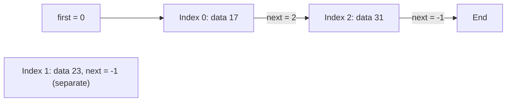

# Chapter 7. Organizing data with links

We will connect items with links to the next item. Then we will use the same nodes to build a stack and a queue.

## Thinking logically

### What does linked data look like?

We use nodes, which have data and a link to the next node. An array stores nodes side by side; links give them a sequence. We call this structure a singly linked list: each node records which node follows it, and the last node has no successor.

In Chapter 1, inserting into the middle of an array list shifts the following values. Here we change links to change the order. The values stay in their array slots.

### How do array positions become a list?

Each node stores two integers: `data` holds a value, and `next` holds the next node's array index. A value of `-1` in `next` means no successor. We keep the first node's index separately in `first`; an empty list has `first = -1`.

Suppose slots 0, 1, and 2 have been assigned for use. They contain 17, 23, and 31. Connect slot 0 to slot 2, and leave slot 1 separate.



The list contains 17 followed by 31. Slot 1 is physically between their slots, but the links do not include it. An index identifies a slot; the data stored there can change when the slot is reused.

### How do we access the whole list?

Starting at `first`, read the current node and follow its `next` link. Repeat until the index is `-1`, checking before accessing the array. Our lists have no cycles, so this walk eventually ends.

To reach the third node, follow two links from the first. Accessing `lnodes[2]` instead selects physical slot 2, which need not be the third node in the list.

### How do we connect a node to this data structure?

Let's insert 23 between 17 and 31.

1. Save the old successor in the new node. Set slot 1's `next` to slot 0's `next`, which is 2.
2. Connect the predecessor to the new node. Set slot 0's `next` to 1.

The list is now `0(17) → 1(23) → 2(31) → -1`. This is what `simple_link_lnode_to_prev(0, 1)` does. If we reverse the assignments, we lose the old successor and make slot 1 point to itself.

The caller supplies two valid, distinct indices. The predecessor is already in an ordinary list, and the new node is allocated for use, outside every chain, with `next = -1`. This function connects nodes; it does not find or allocate them.

### How do we remove a node?

Make its predecessor point to its successor. In our example, `simple_delink_next_lnode_from_prev(0)` saves index 1, connects slot 0 directly to slot 2, sets slot 1's `next` to `-1`, and returns 1.

The list is again `0(17) → 2(31) → -1`. The returned node is detached: it is separate from the list, but still assigned to the caller. If the predecessor has no successor, the function returns `-1` without changing anything.

The first node has no predecessor. To remove it, the caller saves its index and advances `first` to its successor, then sets the removed node's `next` to `-1`. The predecessor helpers do not update queue endpoints, so queued nodes use the queue operations described below.

### Can several lists use one array?

Each list keeps its own first index, so several lists can use different slots in the same array. They can share the available space without reserving a fixed portion for each list. Their nodes must remain separate.

We reserve ten reusable nodes in a node pool. To find an available slot without scanning the array, we connect all unused slots into another list, called the free list. Its first index is `free_head`.

```text
free_head = 0
0 → 1 → 2 → 3 → 4 → 5 → 6 → 7 → 8 → 9 → -1
```

`init_lnodes_pool()` builds this chain on its first call. Later calls preserve the current links; initialization does not reset a pool that is already in use.

### How do we obtain and reuse a node?

`new_lnode()` initializes the pool if necessary, removes the first free node, and sets that node's `next` to `-1`. It returns the node's index, or `-1` if no slot is available. The caller checks the index before writing `data`; allocation does not set the value.

In a fresh pool, three allocations return indices 0, 1, and 2. Store 17, 23, and 31 in them. Connect slot 2 after slot 0, then insert slot 1 after slot 0 to build our example. The free list now begins at 3.

Removing slot 1 from the active list does not return it to the pool. After reading any needed data, call `free_lnode(1)` to put it at the front of the free list: `1 → 3 → 4 → … → 9 → -1`. The next allocation returns slot 1 again with `next = -1`. Its data is still 23 until the new caller assigns another value, such as 8.

Return only an allocated node that is outside every chain and has `next = -1`. Return it once, then stop using it as the old record. These functions reuse array slots; they do not call C's `malloc` or `free`.

### How can the last value added come out first?

A stack adds and removes at the same end. Keep its top in `first`. To add a value, allocate a node, check success, write its data, link it to the old first node, and make it the new first. If allocation fails, leave the stack unchanged.

Adding 17, 23, and 31 gives `31 → 23 → 17`. To remove a value, check that `first` is not `-1`, save the first node's index and data, advance `first` to its successor, and isolate the old node before returning it to the pool.

The values come out as 31, 23, and 17: last in, first out, or LIFO. Removing the last node leaves `first = -1`. These updates belong to the caller; the node functions do not provide a separate stack interface.

### How can a linked list preserve arrival order?

A queue adds at the last node and removes the first. We remember both ends in `qhead` and `qtail`, so neither operation needs a search. Adding 17, 23, and 31 gives `17 → 23 → 31`, and removal returns the values in that same order: first in, first out, or FIFO.

To add a value, allocate a node, check its index, write its data, and pass the index to `enqueue_lnode()`. The node must be outside every chain with `next = -1`. In a nonempty queue, the old tail links to the new node and `qtail` moves to it. In an empty queue, both endpoints become the new node. Enqueuing does not allocate or set data; `enqueue_lnode(-1)` does nothing.

`dequeue_lnode()` advances `qhead`, isolates the old head, and returns its index. Removing the only node also sets `qtail = -1`. An empty queue returns `-1`. Check the returned index, read its data, and return the node to the pool when finished.

The returned index is not the stored value. A data value of `-1` is valid; only an index of `-1` means no node. A reused slot can join the tail regardless of its array position, so reuse preserves arrival order.

## Calculating efficiency

### Memory efficiency for storing

A node stores two `int` members: one value and one link. The array reserves all ten slots even when only some are in use. The pool and queue keep their endpoint indices, and each additional list needs its own first index.

The ten slots limit simultaneous allocations across all users of the pool. Reusing returned slots lets us process more than ten values over time.

### Memory efficiency for iterating over items

An iterative traversal keeps the current index and a fixed amount of temporary state. Its additional memory does not grow with the list's length.

### Efficiency of creating or adding one item

The first initialization connects every pool slot, so its work is proportional to the pool's capacity. The first allocation includes that work if the pool has not yet been initialized.

After initialization, allocating, recycling, inserting after a known predecessor, and removing its successor each take constant time. Stack updates at the first node and queue updates at the saved endpoints also take constant time. Searching for a predecessor is separate work and may visit the whole list.

### Efficiency of iterating over items

Traversal takes time proportional to the number of nodes in the list, assuming a valid chain. Reaching a node by its logical position requires following links, while accessing a known physical array index takes constant time. Nodes in other lists are not visited.

## Glossary

### Node

One integer value together with the next node's index.

### Singly linked list

A sequence in which each node has one link to its successor.

### First node

The node from which the whole list is accessed; its index is saved separately.

### Predecessor

The node immediately before another node in the list.

### Successor

The node immediately after another node in the list.

### Traversal

Following successive links to visit the nodes of a list.

### Cycle

A path of links that returns to a node already visited.

### Node pool

A fixed array of nodes available for repeated use.

### Free list

The chain of available nodes reached from `free_head`.

### Allocation

Taking a node out of the free list and assigning it to a caller.

### Detached node

An allocated node outside every chain, with `next = -1`.

### Recycling

Returning an allocated, detached node to the free list.

### Ownership

Responsibility for keeping a node in exactly one state: free, in one active list, or detached for a caller.

### Stale index

An index retained after returning a node, which no longer identifies the old caller's record.

### Stack

A structure that removes the most recently added item first, following LIFO order.

### Queue

A structure that removes the earliest added item first, following FIFO order.

### Enqueue

Add a node at the queue's tail.

### Dequeue

Remove a node from the queue's head.

## Invariant

### What are the invariants (the golden rules) in this data structure?

- An absent link or endpoint is `-1`; a present one is an index from `0` through `CAPACITY - 1`.
- Every active list and the free list has no cycles and ends at `-1`.
- After initialization, each slot belongs to exactly one active list, the free list, or a caller as a detached node. A detached node has `next = -1`.
- An empty queue has both `qhead = -1` and `qtail = -1`. In a nonempty queue, `qtail` is the last node reached from `qhead`, and its `next` is `-1`.

### What is the benefit of the invariants?

Valid links and the absence of cycles let us visit each node in a list exactly once. Separate ownership lets several lists reuse the pool without changing one another's records. Correct queue endpoints let us add at the tail and remove at the head while preserving FIFO order.

### What happens if an invariant is broken?

An invalid index accesses memory outside the array. A cycle prevents traversal from ending. Returning an active node overwrites a link its list still needs; returning the same node twice can create a cycle in the free list.

Losing the index of a detached node leaves that slot unavailable. Using a stale index after recycling can change the free list or another caller's record. An incorrect queue tail can attach new nodes to the wrong chain.

### How do we keep the invariants intact?

Initialize before use, check returned indices, and preserve a successor before replacing its link. Detach a node before recycling it, read any needed data first, and return it exactly once. Use the queue helpers for queued nodes so both endpoints stay consistent.

These rules hold after each complete operation. The helpers do not check every index or ownership condition; callers must supply valid nodes.

## Coding plan

### Designing a node

Keep `data` and `next` in `struct Linked_Node`; store ten such nodes in a shared array. Keep each ordinary list's first index separately.

### Connecting and detaching nodes

For insertion, give the new node the predecessor's old successor before connecting the predecessor to it. For removal, save the successor's index, bypass it, clear its link, and return its index.

### Preparing the node pool

Connect all slots in array order and put `-1` in the last link. Keep the first available index in `free_head`. Use a local `static` flag so later initializer calls preserve existing lists.

### Allocating and recycling nodes

Allocate by taking the first free node and clearing its link. Check the returned index before assigning its data. Recycle an allocated, detached node by linking it before the current free head, then updating `free_head`.

### Using the nodes as a stack

Add by linking a new node before `first` and updating `first`. Remove by saving the old first node's value and successor, advancing `first`, isolating the old node, and recycling it. Check for allocation failure or an empty stack before changing links.

### Using the nodes as a queue

Keep `qhead` and `qtail`. Append an allocated, isolated node after the tail, setting both endpoints when the queue was empty. Remove the head, clear the tail if the queue becomes empty, and return the detached index. The caller reads its data and recycles it.

## New C syntax explained

### Naming an integer constant with `enum`

`enum { CAPACITY = 10 };` gives the integer constant 10 a name. We use that name in the array declaration and initialization loop so they agree on the pool's size.

### A local `static` variable

`static int initialized = 0;` creates a local variable that keeps its value between function calls. It is initialized once, rather than reset to 0 each time the function runs.

### `void` in a function declaration

In `int new_lnode(void)`, `void` means the function takes no arguments. In `void free_lnode(int node)`, the first `void` means the function returns no value. A plain `return;` ends such a function immediately.

### Chained assignment

`qhead = qtail = node;` assigns `node` to `qtail`, then assigns that same value to `qhead`. Both endpoints identify the single node in a newly nonempty queue.

### Returning a comparison

`return qhead == -1;` returns 1 when the comparison is true and 0 when it is false. An `if` condition treats a nonzero result as true.

## C code

### Node storage

```c
enum { CAPACITY = 10 };

struct Linked_Node {
        int data; // A stored value, not a node index.
        int next; // Next node's array index; -1 means no successor.
};
struct Linked_Node lnodes[CAPACITY];
```

### Connecting a node after its predecessor

```c
void simple_link_lnode_to_prev(int prev, int node) {
        // Requires valid, distinct indices: prev is an allocated non-queue node;
        // node is allocated, outside every chain, and has next = -1.
        lnodes[node].next = lnodes[prev].next; // Preserve the old successor first.
        lnodes[prev].next = node;
}
```

### Detaching the node after a predecessor

```c
int simple_delink_next_lnode_from_prev(int prev) {
        // Requires a valid, allocated non-queue predecessor.
        int node = lnodes[prev].next;
        if (node != -1) {
                lnodes[prev].next = lnodes[node].next; // Bypass the removed node.
                lnodes[node].next = -1; // Isolate it without returning it to the pool.
        }
        return node; // Return an index, or -1 when there was no successor.
}
```

### Initializing the node pool

```c
int free_head = -1;

void init_lnodes_pool(void) {
        static int initialized = 0; // Retain this flag between calls.
        if (initialized) {
                return; // Preserve any nodes already in use.
        }
        initialized = 1;

        for (int i = 0; i < CAPACITY - 1; i++) {
                lnodes[i].next = i + 1;
        }
        lnodes[CAPACITY - 1].next = -1; // End the free chain.
        free_head = 0;
}
```

### Allocating a node

```c
int new_lnode(void) {
        init_lnodes_pool(); // Only the first call builds the free chain.
        if (free_head == -1) {
                return -1; // No available slot; leave the pool unchanged.
        }
        int node = free_head;
        free_head = lnodes[free_head].next;
        lnodes[node].next = -1; // The caller receives an isolated node.
        return node; // Data is unchanged; the caller assigns its new value.
}
```

### Returning a node to the pool

```c
void free_lnode(int node) {
        if (node == -1) {
                return;
        }
        // Requires a valid allocated node outside every chain, with next = -1.
        lnodes[node].next = free_head; // Prepend the node; keep its data unchanged.
        free_head = node;
}
```

### Keeping the queue endpoints

```c
int qhead = -1;
int qtail = -1;

int is_empty_queue(void) {
        return qhead == -1; // The invariant also makes qtail -1 when empty.
}
```

### Adding a node to the queue

```c
void enqueue_lnode(int node) {
        if (node == -1) {
                return;
        }
        // Requires a valid allocated node outside every chain, with next = -1.
        if (is_empty_queue()) {
                qhead = qtail = node; // One node is both the first and the last.
        } else {
                lnodes[qtail].next = node;
                qtail = node;
        }
}
```

### Removing a node from the queue

```c
int dequeue_lnode(void) {
        if (is_empty_queue()) {
                return -1;
        }
        int oldest = qhead;
        qhead = lnodes[qhead].next;
        if (qhead == -1) {
                qtail = -1; // Removing the only node leaves both endpoints empty.
        }
        lnodes[oldest].next = -1;
        return oldest; // The caller reads the data, then recycles the detached node.
}
```
