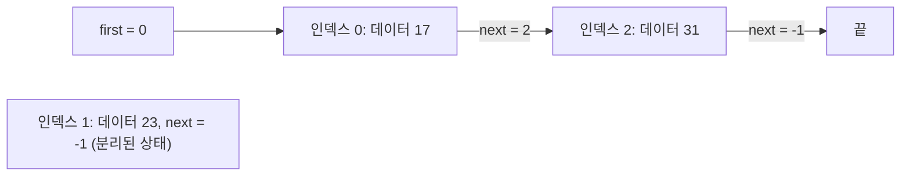

# 7장. 다음 데이터를 연결하기

데이터마다 다음 데이터 정보를 같이 저장해서 리스트를 구성한다. 메모리 공간의 잉여 칸들을 서로 연결해서 관리해본다. 저장된 순서대로 데이터를 꺼내는 큐를 만들어본다.

## 논리적으로 생각해 보기

### 링크로 연결한 데이터는 어떤 모습일까?

데이터와 다음 노드를 향하는 링크를 담은 노드를 사용한다. 배열은 노드를 나란히 저장하고, 링크는 그 노드들에 순서를 부여한다. 이 구조를 단일 연결 리스트라고 한다. 각 노드는 자신의 다음 노드를 기록하며, 마지막 노드에는 다음 노드가 없다.

1장에서 배열 리스트의 중간에 값을 넣으려면 뒤의 값들을 밀어야 했다. 여기서는 링크를 바꾸어 순서를 바꾼다. 값은 원래 배열 칸에 그대로 둔다.

### 배열의 위치를 어떻게 리스트로 연결할까?

각 노드는 정수 두 개를 저장한다. `data`는 값을, `next`는 다음 노드의 배열 인덱스를 담는다. `next`가 `-1`이면 다음 노드가 없다는 뜻이다. 첫 노드의 인덱스는 `first`에 따로 보관한다. 빈 리스트에서는 `first = -1`이다.

사용할 칸으로 0번, 1번, 2번을 할당받았다고 하자. 각 칸에는 17, 23, 31이 들어 있다. 0번 칸을 2번 칸에 연결하고, 1번 칸은 따로 둔다.



리스트에는 17 다음에 31이 있다. 1번 칸은 배열에서 두 칸 사이에 있지만, 링크로 연결되어 있지 않다. 인덱스는 칸의 위치를 나타낸다. 그 칸을 재사용하면 저장된 데이터는 달라질 수 있다.

### 리스트 전체에 어떻게 접근할까?

`first`에서 시작해 현재 노드를 읽고 `next` 링크를 따라간다. 배열에 접근하기 전에 인덱스를 확인하며, `-1`에 도달할 때까지 반복한다. 우리가 다루는 리스트에는 순환이 없으므로 이 과정은 끝난다.

세 번째 노드에 도달하려면 첫 노드에서 링크 두 개를 따라간다. `lnodes[2]`에 접근하면 배열의 2번 칸을 선택한다. 그 칸이 리스트의 세 번째 노드인 것은 아니다.

### 이 자료구조에 노드를 어떻게 연결할까?

17과 31 사이에 23을 넣어보자.

1. 기존 다음 노드를 새 노드에 기록한다. 1번 칸의 `next`에 0번 칸의 `next` 값인 2를 저장한다.
2. 앞 노드를 새 노드에 연결한다. 0번 칸의 `next`를 1로 바꾼다.

이제 리스트는 `0(17) → 1(23) → 2(31) → -1`이다. `simple_link_lnode_to_prev(0, 1)`이 이 일을 한다. 두 대입의 순서를 뒤집으면 기존 다음 노드를 잃고, 1번 칸이 자기 자신을 가리키게 된다.

호출자는 유효하고 서로 다른 인덱스 두 개를 전달한다. 앞 노드는 이미 일반 리스트에 속해 있어야 한다. 새 노드는 사용하도록 할당받았으며, 어느 연결에도 속하지 않고 `next = -1`이어야 한다. 이 함수는 노드를 연결한다. 노드를 찾거나 할당하는 일은 별도다.

### 노드를 어떻게 제거할까?

제거할 노드의 앞 노드가 그다음 노드를 가리키도록 바꾼다. 예제에서 `simple_delink_next_lnode_from_prev(0)`은 인덱스 1을 저장하고, 0번 칸을 2번 칸에 바로 연결한다. 그런 다음 1번 칸의 `next`를 `-1`로 바꾸고 1을 반환한다.

리스트는 다시 `0(17) → 2(31) → -1`이 된다. 반환된 노드는 리스트에서 분리되었지만, 여전히 호출자에게 할당된 상태다. 앞 노드에 다음 노드가 없으면 아무것도 바꾸지 않고 `-1`을 반환한다.

첫 노드에는 앞 노드가 없다. 첫 노드를 제거하려면 호출자가 그 인덱스를 저장하고, `first`를 다음 노드의 인덱스로 바꾼 뒤, 제거한 노드의 `next`를 `-1`로 만든다. 앞 노드를 사용하는 두 함수는 큐의 양 끝 인덱스를 갱신하지 않는다. 큐에 속한 노드는 아래에서 설명할 큐 연산으로 처리한다.

### 여러 리스트가 한 배열을 사용할 수 있을까?

각 리스트가 자신의 첫 인덱스를 따로 보관하면 같은 배열의 서로 다른 칸을 사용할 수 있다. 리스트마다 고정된 공간을 나누어 예약하지 않고 남은 공간을 함께 쓴다. 각 리스트에 속한 노드는 서로 겹치지 않아야 한다.

재사용할 노드 열 개를 노드 풀에 확보한다. 배열 전체를 검색하지 않고 사용 가능한 칸을 찾기 위해, 사용하지 않는 모든 칸을 또 하나의 리스트로 연결한다. 이를 가용 리스트라고 한다. 첫 인덱스는 `free_head`다.

```text
free_head = 0
0 → 1 → 2 → 3 → 4 → 5 → 6 → 7 → 8 → 9 → -1
```

`init_lnodes_pool()`은 처음 호출될 때 이 연결을 만든다. 이후 호출에서는 현재 링크를 보존한다. 이미 사용 중인 풀을 처음 상태로 되돌리는 함수가 아니다.

### 노드를 어떻게 얻고 재사용할까?

`new_lnode()`은 필요하면 풀을 초기화하고, 첫 가용 노드를 떼어 낸 뒤 그 노드의 `next`를 `-1`로 만든다. 해당 노드의 인덱스를 반환하며, 사용 가능한 칸이 없으면 `-1`을 반환한다. 호출자는 인덱스를 확인한 뒤 `data`에 값을 쓴다. 할당 자체는 데이터 값을 설정하지 않는다.

처음 상태의 풀에서 세 번 할당하면 인덱스 0, 1, 2를 얻는다. 각 칸에 17, 23, 31을 저장한다. 0번 칸 뒤에 2번 칸을 연결하고, 다시 0번 칸 뒤에 1번 칸을 넣으면 앞의 예제가 된다. 가용 리스트는 이제 3번 칸에서 시작한다.

사용 중인 리스트에서 1번 칸을 분리해도 그 칸이 풀로 돌아가지는 않는다. 필요한 데이터를 읽은 뒤 `free_lnode(1)`을 호출하면 가용 리스트의 맨 앞에 붙는다. 연결은 `1 → 3 → 4 → … → 9 → -1`이 된다. 다음 할당은 1번 칸을 다시 돌려주며, 그때 `next = -1`이다. 새 호출자가 8과 같은 다른 값을 저장하기 전까지 데이터는 여전히 23이다.

할당받은 노드 중 어느 연결에도 속하지 않고 `next = -1`인 노드만 풀에 반환한다. 한 번 반환한 뒤에는 이전 기록으로 사용하지 않는다. 이 함수들은 배열 칸을 재사용하며, C의 `malloc`이나 `free`를 호출하지 않는다.

### 마지막에 넣은 값을 어떻게 먼저 꺼낼까?

스택은 같은 쪽에서 추가하고 제거한다. 맨 위 노드의 인덱스를 `first`에 보관한다. 값을 넣으려면 노드를 할당하고 성공 여부를 확인한 뒤 데이터를 쓴다. 새 노드를 기존 첫 노드에 연결하고, 새 노드를 첫 노드로 삼는다. 할당에 실패하면 스택을 그대로 둔다.

17, 23, 31을 차례로 넣으면 `31 → 23 → 17`이 된다. 값을 꺼낼 때는 `first`가 `-1`이 아닌지 확인하고, 첫 노드의 인덱스와 데이터를 저장한다. `first`를 다음 노드로 옮기고, 기존 첫 노드를 분리한 뒤 풀에 반환한다.

값은 31, 23, 17 순서로 나온다. 마지막에 넣은 것을 먼저 꺼내는 후입선출, 즉 LIFO다. 마지막 노드를 제거하면 `first = -1`이 된다. 이 갱신은 호출자가 수행한다. 노드 함수들은 별도의 스택 인터페이스를 제공하지 않는다.

### 연결 리스트로 도착한 순서를 어떻게 지킬까?

큐는 마지막 노드 뒤에 추가하고 첫 노드를 제거한다. 양 끝 인덱스를 `qhead`와 `qtail`에 기억하므로 두 연산 모두 검색할 필요가 없다. 17, 23, 31을 차례로 넣으면 `17 → 23 → 31`이 되며, 꺼낼 때도 같은 순서를 따른다. 먼저 넣은 것을 먼저 꺼내는 선입선출, 즉 FIFO다.

값을 넣으려면 노드를 할당하고 인덱스를 확인한 뒤 데이터를 쓰고, 그 인덱스를 `enqueue_lnode()`에 전달한다. 노드는 어느 연결에도 속하지 않고 `next = -1`이어야 한다. 큐가 비어 있지 않으면 기존 마지막 노드를 새 노드에 연결하고 `qtail`을 새 노드로 옮긴다. 빈 큐라면 양 끝 인덱스가 모두 새 노드의 인덱스가 된다. 이 함수는 노드를 할당하거나 데이터를 설정하지 않는다. `enqueue_lnode(-1)`은 아무것도 하지 않는다.

`dequeue_lnode()`은 `qhead`를 다음 노드로 옮기고, 기존 첫 노드를 분리한 뒤 그 인덱스를 반환한다. 유일한 노드를 제거했다면 `qtail = -1`로 만든다. 빈 큐에서는 `-1`을 반환한다. 반환된 인덱스를 확인하고 데이터를 읽은 뒤, 사용을 마치면 노드를 풀에 반환한다.

반환된 인덱스와 저장된 값은 구별한다. 데이터 값으로 `-1`을 저장할 수 있다. 노드가 없다는 뜻은 인덱스가 `-1`일 때다. 재사용한 칸은 배열에서의 위치와 관계없이 큐의 끝에 붙으므로 도착한 순서가 유지된다.

## 효율 계산해보기

### 저장할 때의 메모리 효율

노드는 `int` 멤버 두 개를 저장한다. 하나는 값이고 다른 하나는 링크다. 배열은 일부 칸만 사용하더라도 열 칸 전체의 공간을 확보한다. 풀은 가용 리스트의 첫 인덱스를, 큐는 양 끝 인덱스를 보관한다. 리스트가 추가될 때마다 자신의 첫 인덱스가 필요하다.

열 칸은 풀을 사용하는 모든 곳에서 동시에 할당받을 수 있는 노드 수를 제한한다. 반환한 칸을 재사용하면 시간이 흐르는 동안 열 개보다 많은 값을 처리할 수 있다.

### 순회할 때의 메모리 효율

반복문으로 순회할 때는 현재 인덱스와 일정한 양의 임시 상태를 보관한다. 추가로 필요한 메모리는 리스트가 길어져도 늘어나지 않는다.

### 항목 하나를 만들거나 추가하는 효율

첫 초기화는 풀의 모든 칸을 연결하므로 작업량이 풀의 용량에 비례한다. 아직 풀을 초기화하지 않았다면 첫 할당에 이 작업이 포함된다.

초기화 이후에는 할당, 반환, 알고 있는 앞 노드 뒤에 삽입하기, 그다음 노드 제거하기가 각각 상수 시간에 끝난다. 첫 노드에서 수행하는 스택 갱신과 저장한 양 끝에서 수행하는 큐 갱신도 상수 시간이 든다. 앞 노드를 찾는 일은 별도이며, 리스트 전체를 방문해야 할 수 있다.

### 항목을 순회하는 효율

올바른 연결에서 순회 시간은 리스트의 노드 수에 비례한다. 논리적 순서로 노드를 찾으려면 링크를 따라가야 한다. 알고 있는 배열 인덱스에 직접 접근하는 데는 상수 시간이 든다. 다른 리스트에 속한 노드는 방문하지 않는다.

## 용어 정리

### 노드 (Node)

정수값 하나와 다음 노드의 인덱스를 함께 저장한 것.

### 단일 연결 리스트 (Singly Linked List)

각 노드가 다음 노드를 향하는 링크 하나를 가진 순서 있는 구조.

### 첫 노드 (First Node)

리스트 전체에 접근하는 출발점인 노드. 그 인덱스를 따로 보관한다.

### 앞 노드 (Predecessor)

리스트에서 어떤 노드의 바로 앞에 있는 노드.

### 다음 노드 (Successor)

리스트에서 어떤 노드의 바로 뒤에 있는 노드.

### 순회 (Traversal)

링크를 차례로 따라가며 리스트의 노드들을 방문하는 것.

### 순환 (Cycle)

링크를 따라가다 이미 방문한 노드로 돌아오는 경로.

### 노드 풀 (Node Pool)

반복해서 사용할 노드를 저장한 고정 크기 배열.

### 가용 리스트 (Free List)

`free_head`에서 접근하는 사용 가능한 노드들의 연결.

### 할당 (Allocation)

가용 리스트에서 노드를 꺼내 호출자가 사용하도록 주는 것.

### 분리된 노드 (Detached Node)

할당된 노드 중 어느 연결에도 속하지 않고 `next = -1`인 노드.

### 반환 (Recycling)

할당받고 분리한 노드를 가용 리스트로 돌려주는 것.

### 소유 책임 (Ownership)

노드를 가용 상태, 사용 중인 한 리스트에 속한 상태, 호출자가 보관하는 분리된 상태 중 정확히 하나로 유지할 책임.

### 이전 소유자의 인덱스 (Stale Index)

노드를 반환한 뒤에도 보관한 인덱스. 더는 이전 호출자의 기록을 가리키지 않는다.

### 스택 (Stack)

가장 최근에 추가한 항목부터 꺼내는 LIFO 구조.

### 큐 (Queue)

가장 먼저 추가한 항목부터 꺼내는 FIFO 구조.

### 큐에 넣기 (Enqueue)

큐의 마지막 노드 뒤에 노드를 추가하는 것.

### 큐에서 꺼내기 (Dequeue)

큐의 첫 노드를 제거하는 것.

## 규칙

### 이 자료구조의 규칙은 무엇일까?

- 링크나 양 끝이 가리킬 노드가 없으면 `-1`을 저장한다. 노드가 있으면 `0`부터 `CAPACITY - 1`까지의 인덱스를 저장한다.
- 사용 중인 모든 리스트와 가용 리스트에는 순환이 없으며, `-1`에서 끝난다.
- 초기화 이후 각 칸은 사용 중인 리스트 하나, 가용 리스트, 호출자가 보관하는 분리된 노드 중 정확히 한 곳에 속한다. 분리된 노드의 `next`는 `-1`이다.
- 빈 큐에서는 `qhead = -1`과 `qtail = -1`이 모두 성립한다. 비어 있지 않은 큐에서는 `qtail`이 `qhead`에서 도달하는 마지막 노드이며, 그 노드의 `next`는 `-1`이다.

### 규칙을 지키면 무엇이 좋을까?

링크가 유효하고 순환이 없으면 리스트의 각 노드를 정확히 한 번씩 방문할 수 있다. 소유 관계가 겹치지 않으면 여러 리스트가 서로의 기록을 바꾸지 않고 풀을 재사용한다. 큐의 양 끝이 올바르면 끝에 추가하고 앞에서 제거하여 FIFO 순서를 지킬 수 있다.

### 규칙이 깨지면 어떻게 될까?

범위를 벗어난 인덱스는 배열 밖의 메모리에 접근하게 한다. 순환이 있으면 순회가 끝나지 않는다. 사용 중인 노드를 반환하면 해당 리스트에 필요한 링크를 덮어쓴다. 같은 노드를 두 번 반환하면 가용 리스트에 순환이 생길 수 있다.

분리된 노드의 인덱스를 잃으면 그 칸을 사용할 수 없게 된다. 반환한 뒤 이전 인덱스로 접근하면 가용 리스트나 다른 호출자의 기록을 바꿀 수 있다. 큐의 마지막 인덱스가 잘못되면 새 노드를 엉뚱한 연결에 붙일 수 있다.

### 규칙을 어떻게 지킬까?

사용 전에 초기화하고, 반환된 인덱스를 확인하며, 링크를 바꾸기 전에 다음 노드를 보존한다. 노드를 반환하기 전에 분리하고 필요한 데이터를 먼저 읽는다. 반환은 정확히 한 번만 한다. 큐에 속한 노드는 큐 함수를 사용하여 양 끝 인덱스를 일관되게 유지한다.

이 규칙들은 하나의 연산을 마쳤을 때 성립해야 한다. 함수들이 모든 인덱스나 소유 조건을 검사하지는 않으므로 호출자가 유효한 노드를 전달해야 한다.

## 코딩 계획

### 노드 설계하기

`struct Linked_Node`에 `data`와 `next`를 두고, 공유 배열에 노드 열 개를 저장한다. 각 일반 리스트의 첫 인덱스는 따로 보관한다.

### 노드 연결하고 분리하기

삽입할 때는 앞 노드의 기존 다음 노드를 새 노드에 기록한 뒤 앞 노드를 새 노드에 연결한다. 제거할 때는 다음 노드의 인덱스를 저장하고, 그 노드를 건너뛰도록 연결한 뒤, 제거한 노드의 링크를 비우고 그 인덱스를 반환한다.

### 노드 풀 준비하기

모든 칸을 배열 순서대로 연결하고 마지막 링크에 `-1`을 넣는다. 첫 가용 인덱스는 `free_head`에 보관한다. 지역 `static` 변수를 표시로 사용하여 이후 초기화 호출에서도 기존 리스트를 보존한다.

### 노드 할당하고 반환하기

첫 가용 노드를 떼어 내고 링크를 비워 할당한다. 반환된 인덱스를 확인한 뒤 데이터를 저장한다. 할당받고 분리한 노드는 현재 가용 리스트의 맨 앞에 연결하고 `free_head`를 갱신하여 반환한다.

### 노드를 스택으로 사용하기

새 노드를 `first` 앞에 연결하고 `first`를 갱신하여 추가한다. 제거할 때는 기존 첫 노드의 값과 다음 노드를 저장하고, `first`를 옮긴 뒤, 기존 노드를 분리하여 반환한다. 링크를 바꾸기 전에 할당 실패나 빈 스택인지 확인한다.

### 노드를 큐로 사용하기

`qhead`와 `qtail`을 보관한다. 할당받고 분리된 노드를 마지막 노드 뒤에 붙인다. 빈 큐였다면 양 끝을 모두 설정한다. 첫 노드를 제거한 뒤 큐가 비었으면 마지막 인덱스도 비우고, 분리된 인덱스를 반환한다. 호출자는 데이터를 읽고 그 노드를 풀에 반환한다.

## 새로운 C 문법 설명

### `enum`으로 정수 상수에 이름 붙이기

`enum { CAPACITY = 10 };`은 정수 상수 10에 이름을 붙인다. 배열 선언과 초기화 반복문에서 이 이름을 사용하면 풀의 크기를 같게 유지할 수 있다.

### 지역 `static` 변수

`static int initialized = 0;`은 함수 호출 사이에도 값을 유지하는 지역 변수를 만든다. 한 번만 초기화하며, 함수를 실행할 때마다 0으로 되돌리지 않는다.

### 함수 선언의 `void`

`int new_lnode(void)`의 `void`는 인자를 받지 않는다는 뜻이다. `void free_lnode(int node)`의 앞쪽 `void`는 반환값이 없다는 뜻이다. 이런 함수에서 `return;`은 함수를 즉시 끝낸다.

### 연속 대입

`qhead = qtail = node;`는 `node`를 `qtail`에 대입한 뒤 같은 값을 `qhead`에 대입한다. 빈 큐에 노드 하나를 넣으면 양 끝이 모두 그 노드를 가리킨다.

### 비교 결과 반환하기

`return qhead == -1;`은 비교가 참이면 1, 거짓이면 0을 반환한다. `if` 조건은 0이 아닌 값을 참으로 판단한다.

## C 코드

### 노드 저장 공간

데이터 값과 다음 노드의 인덱스가 각각 어디에 저장되는지 설명해보자.

```c
enum { CAPACITY = 10 };

struct Linked_Node {
        int data; // 저장한 값이다. 노드의 인덱스와 구별한다.
        int next; // 다음 노드의 배열 인덱스다. -1은 다음 노드 없음을 뜻한다.
};
struct Linked_Node lnodes[CAPACITY];
```

### 앞 노드 뒤에 새 노드 연결하기

두 대입의 순서를 바꾸면 어떤 링크가 사라지는지 설명해보자.

```c
void simple_link_lnode_to_prev(int prev, int node) {
        // 유효하고 서로 다른 인덱스를 가정한다. prev는 할당된 큐 외부의 노드다.
        // node는 할당된 상태이며, 어느 연결에도 속하지 않고 next = -1이다.
        lnodes[node].next = lnodes[prev].next; // 기존 다음 노드를 먼저 보존한다.
        lnodes[prev].next = node;
}
```

### 앞 노드의 다음 노드 분리하기

반환된 인덱스와 분리된 노드의 링크가 어떤 상태인지 설명해보자.

```c
int simple_delink_next_lnode_from_prev(int prev) {
        // 유효하고 할당된 큐 외부의 앞 노드를 가정한다.
        int node = lnodes[prev].next;
        if (node != -1) {
                lnodes[prev].next = lnodes[node].next; // 제거할 노드를 건너뛰어 연결한다.
                lnodes[node].next = -1; // 풀에 반환하지 않고 분리만 한다.
        }
        return node; // 인덱스를 반환한다. 다음 노드가 없었다면 -1이다.
}
```

### 노드 풀 초기화하기

첫 호출이 만드는 연결과 이후 호출이 바로 끝나는 이유를 설명해보자.

```c
int free_head = -1;

void init_lnodes_pool(void) {
        static int initialized = 0; // 호출 사이에도 이 표시를 유지한다.
        if (initialized) {
                return; // 이미 사용 중인 노드를 보존한다.
        }
        initialized = 1;

        for (int i = 0; i < CAPACITY - 1; i++) {
                lnodes[i].next = i + 1;
        }
        lnodes[CAPACITY - 1].next = -1; // 가용 리스트의 끝을 표시한다.
        free_head = 0;
}
```

### 노드 할당하기

`free_head`가 어떻게 변하며, 반환된 노드의 데이터와 링크는 어떤 상태인지 설명해보자.

```c
int new_lnode(void) {
        init_lnodes_pool(); // 첫 호출에서만 가용 리스트를 만든다.
        if (free_head == -1) {
                return -1; // 사용 가능한 칸이 없으면 풀을 그대로 둔다.
        }
        int node = free_head;
        free_head = lnodes[free_head].next;
        lnodes[node].next = -1; // 호출자는 분리된 노드를 받는다.
        return node; // 데이터는 그대로다. 호출자가 새 값을 저장한다.
}
```

### 노드를 풀에 반환하기

노드를 가용 리스트의 맨 앞에 붙이는 과정과 반환 전 조건을 설명해보자.

```c
void free_lnode(int node) {
        if (node == -1) {
                return;
        }
        // 유효하게 할당된 노드이며, 어느 연결에도 속하지 않고 next = -1이어야 한다.
        lnodes[node].next = free_head; // 맨 앞에 붙인다. 데이터는 바꾸지 않는다.
        free_head = node;
}
```

### 큐의 양 끝 보관하기

`qhead`만 검사해도 큐가 비었는지 알 수 있는 이유를 설명해보자.

```c
int qhead = -1;
int qtail = -1;

int is_empty_queue(void) {
        return qhead == -1; // 빈 큐에서는 규칙에 따라 qtail도 -1이다.
}
```

### 큐에 노드 추가하기

빈 큐와 비어 있지 않은 큐에서 갱신하는 값이 어떻게 다른지 설명해보자.

```c
void enqueue_lnode(int node) {
        if (node == -1) {
                return;
        }
        // 유효하게 할당된 노드이며, 어느 연결에도 속하지 않고 next = -1이어야 한다.
        if (is_empty_queue()) {
                qhead = qtail = node; // 노드 하나가 처음이면서 마지막이다.
        } else {
                lnodes[qtail].next = node;
                qtail = node;
        }
}
```

### 큐에서 노드 제거하기

마지막 노드를 제거할 때 `qtail`도 바꾸어야 하는 이유를 설명해보자.

```c
int dequeue_lnode(void) {
        if (is_empty_queue()) {
                return -1;
        }
        int oldest = qhead;
        qhead = lnodes[qhead].next;
        if (qhead == -1) {
                qtail = -1; // 유일한 노드를 제거하면 양 끝이 모두 비게 된다.
        }
        lnodes[oldest].next = -1;
        return oldest; // 호출자가 데이터를 읽은 뒤 분리된 노드를 풀에 반환한다.
}
```
