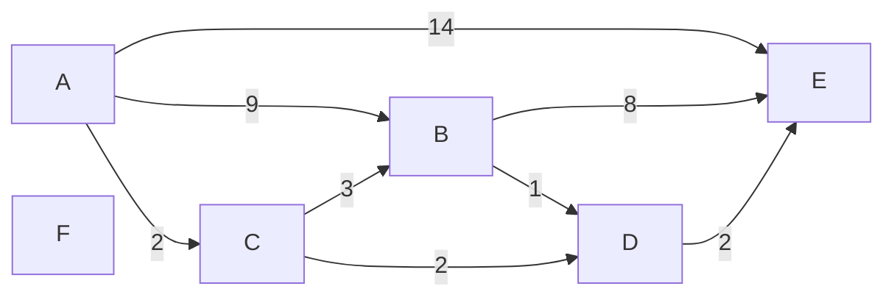

# Dijkstra Models — Indexed Node Heap

Each visual has a linear text equivalent. No meaning depends on color or
spatial position. These models describe [student/lab.c](../student/lab.c),
whose heap stores node IDs and whose distances are separate changing keys.

## Model 1 — The canonical positive weighted graph



Linear equivalent: IDs are A=0, B=1, C=2, D=3, E=4, F=5. In adjacency order,
A points to B9,C2,E14; B points to D1,E8; C points to B3,D2; D points to E2.
E and F have no outgoing edges. No path from A reaches F. Each adjacency
list stores only IDs; `edge_length[u][v]` supplies the corresponding cost.

For this fixture, initialize the imported node array, set `nodes_size=6`,
and install those directions explicitly. Module 03's `edges_init()` builds
a different undirected graph. A matrix entry alone never creates an edge.

## Model 2 — Two objectives

```text
BFS:          A --------14--------> E
              1 edge, cost 14

cost witness: A --2--> C --2--> D --2--> E
              3 edges, cost 6
```

Linear equivalent: BFS minimizes the number of edges and chooses A,E. The
three-edge route A,C,D,E has smaller total cost. Dijkstra minimizes total
weight under its weight assumptions. This lab computes distances; the drawn
route is a manually checked witness, not a returned predecessor path.

## Model 3 — Positions, IDs, keys, and the inverse map

After processing C, the live heap is `[D,E,B]`:

```text
                    position 0
                    node D (ID 3)
                    key 4
                   /     \
          position 1     position 2
          node E (ID 4)   node B (ID 1)
          key 14         key 5

heap:               [3,4,1]
node_heap_pos[D]:    0
node_heap_pos[E]:    1
node_heap_pos[B]:    2
```

Linear equivalent: position 0 holds ID 3, whose key is `node_dist[3]==4`.
Position1 holds ID 4/key 14; position 2 holds ID 1/key 5. Root key 4 is no larger
than either child. Siblings need not be sorted. For each live position i,
`node_heap_pos[heap[i]]==i`. `comp(0,2)` compares D4 and B5 by reading
`node_dist[heap[0]]` and `node_dist[heap[2]]`.

`heap_parent`, `left`, and `right` return positions; `remove_root` returns
a node ID; `update_value` receives a node ID. Each `swap` receives positions
and updates both moved IDs' maps. A node ID is not interchangeable with its
current heap position.

## Model 4 — A queued improvement edits one entry

```text
before removing C:  heap[C,B,E], B distance9
remove C:           heap[B,E]
update_value(B,5):  heap[B,E],   B distance5
add_node(D,4):      heap[D,E,B]
```

Linear equivalent: after C is removed, B remains queued at position 0.
C→B proposes `2+3=5`, so B's key changes from9 to5 without another insertion.
C→D discovers D4 and inserts D at the end; upward repair exchanges D with B.
The active array contains one B. No old B9 snapshot remains.

Repair follows the displaced item. `heapify_down` saves its selected child
position, swaps with it, and continues at that saved position. Rechoosing the
child after swapping could select a sibling whose key now looks preferable.

## Model 5 — Exact run timeline

Each row shows state after inspecting the removed node's outgoing row.

| Event | `node_dist[A..F]` | Live IDs | Live keys |
|---|---|---|---|
| initialize A | `0,-1,-1,-1,-1,-1` | `[A]` | `[0]` |
| remove A | `0,9,2,-1,14,-1` | `[C,B,E]` | `[2,9,14]` |
| remove C | `0,5,2,4,14,-1` | `[D,E,B]` | `[4,14,5]` |
| remove D | `0,5,2,4,6,-1` | `[B,E]` | `[5,6]` |
| remove B | `0,5,2,4,6,-1` | `[E]` | `[6]` |
| remove E | `0,5,2,4,6,-1` | `[]` | `[]` |

Linear equivalent: finalize A,C,D,B,E. First discoveries insert B,C,E,D;
the source A is also inserted. C decreases B9→5 and D decreases E14→6.
B proposes D6 and E13, so neither distance changes. The run makes five adds,
five removals, two updates, and eight adjacency inspections. Peak live size
is three. Six edge relaxations succeed: four first discoveries and two
updates, with source insertion counted separately. There are no duplicates
or stale pops. The lab stores no counters
or finalization-order array; these counts come from the trace.

## Model 6 — The three relaxation branches

```text
candidate = node_dist[node] + edge_length[node][adj]

node_dist[adj] == -1 ?
    yes -> add_node(adj,candidate)
    no  -> node_dist[adj] > candidate ?
               yes -> update_value(adj,candidate)
               no  -> leave distance and heap unchanged
```

Linear equivalent: an undiscovered neighbor is inserted exactly once. A
strict improvement to a queued neighbor edits its shared key and repairs
the existing entry. Equality or a larger candidate causes no call. Equal
heap keys, in contrast, may swap during repair because `comp` uses strict
`<`. No stable arrival-order or node-ID tie promise follows.

In a separate equal-route fixture, A→B2,A→C2,B→D3,C→D3, the first discovered
D5 is not rewritten by the equal candidate5. B/C removal order is not part
of the contract. Assert correct distances and valid heap order instead.

## Model 7 — Live-map boundary and positive continuation

```text
before removing C: heap[C,B,E], size 3
swap(0,--size):    heap[E,B | C], size 2
repair downward:  heap[B,E | C], size 2
                                  inactive slot
```

Linear equivalent: C's map is updated to position 2 by the swap, but position 2
is outside the live prefix. Later D can use that slot. The removed map is
stale and is not a membership flag. Only live nodes satisfy the inverse-map
contract. The source does not clear a removed map to `-1`.

`found[node]=1` records each removal, but no branch reads `found`. With
positive weights, correct heap order, and representable sums, the removed
minimum cannot improve later. That mathematical fact keeps `update_value`
from using a removed node's stale position. Negative weights invalidate the
argument; the lab provides no rejection or alternative negative-edge method.

## Model 8 — Caller assumptions and storage

```text
caller loads valid adjacency IDs and positive int weights
    -> init_dist resets heap, maps, all distances and flags
    -> source key 0 enters heap
    -> valid add/remove/update operations
    -> reachable distances; unreachable stays -1
```

Linear equivalent: the caller ensures IDs 0–9, row bounds, no duplicate
insertion, free capacity before adding, a nonempty heap before removing, and
an active entry before updating. All candidate additions must fit in `int`.
The source has no input validator or overflow guard. `-1` is the unseen
sentinel, not an overflow result. Repeated `min_dist` calls reset algorithm
state while retaining graph data. A singleton removal safely calls downward
repair on the empty heap because both child helpers return `-1`.

For generalized V and E, heap-related state uses `O(V)` space and the run
uses `O(V + (V+E) log V)` work. The separate weight matrix reserves `O(V²)`
space. Actual arrays fix V at at most10. A linear minimum-selection reference
uses `O(V²+E)` work; BFS uses `O(V+E)` work while optimizing edge count.

## Separate optional representation

The retained library in `code/include`, `starter`, `solution`, and `support`
uses distance snapshots and lazy duplicates. Its stable sequence rule,
`SIZE_MAX` sentinel, parser, checked arithmetic, predecessor/path outputs,
and stale pops describe that optional API only. Do not superimpose its
frontier size or counts on these indexed-heap models.
